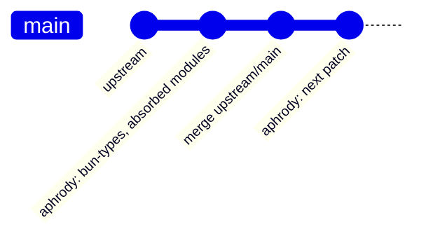

# Aphrody Bun Fork — Architecture, Synchronization & Optimization Hub

> **Repository Nexus**: [aphrody-labs/bun](https://github.com/aphrody-labs/bun)
> **Upstream Authority**: [oven-sh/bun](https://github.com/oven-sh/bun)
> **Organization**: `aphrody-labs`
> **Checkout Path**: `vendor/bun` (pin: `config/vendor.json`, not a Git submodule)
> **Fork Branch**: `main` (single and default branch: upstream `main` plus the Aphrody patches)
> **Sync & Drift Engine**: [`scripts/tools/vendor/bun_upstream_sync.ts`](../scripts/tools/vendor/bun_upstream_sync.ts)
> **PR & Issue Tracker Engine**: [`scripts/tools/vendor/bun_upstream_tracker.ts`](../scripts/tools/vendor/bun_upstream_tracker.ts)
> **Tracker Live Dashboard**: [BUN_UPSTREAM_TRACKER.md](BUN_UPSTREAM_TRACKER.md)

---

## 1. Fork Architecture: one branch



Since 2026-10-05 the fork has a single Aphrody working branch, **`main`** (also the GitHub default branch); the former
`yolo` integration branch was fast-forwarded into it and deleted. The fork also keeps hundreds of branches inherited from
`oven-sh/bun` and the prototype branch `aphrody`; none of them feeds the pin.

- `main` = upstream `oven-sh/bun:main` + the Aphrody patches, as commits on top (Tauri-aware type
  definitions `packages/bun-types/tauri.d.ts` (not in repo), modules resolved
  as built-ins, Rust native dependencies of the Linux linker).
- Upstream arrives by merge (`upstream/main` into `main`), never by rebase or force push.
- Optional `patches/bun/*.patch` files (root of this repo) are reapplied by the sync engine with
  `--apply --reapply-patches` when the fork checks fail after an upstream refactor.
- `yolo forge` (`config/bun-forge.json`) watches and builds `main`; `config/vendor.json` pins the
  qualified commit.

---

## 2. Git Remotes Matrix

| Remote Name    | Target URL                            | Protocol              | Access Level                  |
| :------------- | :------------------------------------ | :-------------------- | :---------------------------- |
| **`origin`**   | `git@github-dev:aphrody-labs/bun.git` | SSH / Rewritten HTTPS | Read / Write (`aphrody-labs`) |
| **`upstream`** | `https://github.com/oven-sh/bun.git`  | HTTPS                 | Read-Only (Official Bun Core) |

---

The consolidation architecture follows the verified native source topology;
see [Architecture de consolidation fondée sur Bun upstream](architecture/bun-upstream.md).

## 3. Automation Toolchain & CLI Commands

The engines run directly with Bun (no `package.json` aliases):

| Command                                                            | Action                | Description                                                                                                                                             |
| :----------------------------------------------------------------- | :-------------------- | :------------------------------------------------------------------------------------------------------------------------------------------------------ |
| `bun scripts/tools/vendor/bun_upstream_sync.ts --dry-run`          | Sync Simulation       | Reports commit distances and drift from local refs, without fetching or touching the working tree. Needs `upstream/main` and `main` (or `origin/main`). |
| `bun scripts/tools/vendor/bun_upstream_sync.ts --apply`            | Auto-Sync Upstream    | Fetches `upstream`, merges `upstream/main` into `main`, runs the fork checks, pushes `origin/main` (never forced).                                      |
| `bun scripts/tools/vendor/bun_upstream_sync.ts --apply --auto-fix` | Drift Auto-Repair     | Resolves conflicts on lockfiles and completions, re-applies Aphrody patches if diverged.                                                                |
| `bun scripts/tools/vendor/bun_upstream_tracker.ts`                 | Upstream Intelligence | Scans upstream PRs and issues for performance optimizations, memory fixes, and crashes.                                                                 |

`vendor/bun` is a shallow, blobless checkout: without local refs, measure drift server side
(`aphrody git api "/repos/oven-sh/bun/compare/main...aphrody-labs:bun:main"`), then let the engine
fetch and merge (`--apply`, commits as `aphrody-dev`, never forced). A new `main` head is qualified by
`yolo forge build` on the build host before `config/vendor.json` moves.

---

## 4. Key Upstream Optimization Discoveries for Aphrody Fork

Based on automated upstream tracking:

1. **`BUN_JSC_numberOfGCMarkers=1` (Issue #44186)**:
   - Allocating workers contend on GC marking threads. For 4-8 worker agent fleets, capping GC markers halves wall time.
2. **`SQLITE_DEFAULT_MEMSTATUS=0` (Issue #44187)**:
   - Upstream SQLite reads contend on global mutex when memory status is tracked. Setting `SQLITE_DEFAULT_MEMSTATUS=0` unlocks concurrent worker reads.
3. **HTTP Head Buffer Optimization (Issue #44208)**:
   - Avoids quadratic buffer copy for non-upgrade HTTP requests in agent servers.
4. **Socket Drainage & TLS State Fix (PR #42351 & PR #44327)**:
   - Critical stability fix preventing orphaned WebSocket connections in high-frequency Obscura CDP interaction loops.

---

## 5. Pin Integrity

`vendor/bun` is not a Git submodule: `config/vendor.json` pins the qualified `main` commit, fetched by
`bun scripts/tools/vendor/fetch.ts`.

- Current pin: the `ref` of the `bun` entry in `config/vendor.json`
- Verification: `git -C vendor/bun rev-parse HEAD` against that `ref`

## 6. Factory qualification — 2026-10-07

The refreshed candidate `0d87bb8fcbeef9af491b2e35466300f49efab957` incorporates upstream
`bd599f5af912512b83bba0ef387d1ba3a7d5e550` and the Aphrody patches. It was built and tested before an
ordinary merge into the existing private fork's `main`, preserving the previous head
`8c744781ed9e9940999b7012c4dc48ac31863cbb` as an ancestor. The resulting, remotely verified head is
[`085dd0ad5e2356f805ecb1b5d51f7cc28da802af`](https://github.com/aphrody-labs/bun/commit/085dd0ad5e2356f805ecb1b5d51f7cc28da802af).
Its tree `91167c557c37aebf1145fc00186552c7c204b854` exactly matches the qualified candidate.

The merged revision was rebuilt through the source owner, `packages/engine/forge`, on the VPS with both
factory locks, an isolated mirror/state/scratch directory, shared toolchain/build caches, release
ThinLTO, four build jobs and `--tests`. `--yolo-root` selected the clean Aphrody checkout `81cd80a`
with frozen Bun dependencies, compiling the Yolo CLI onto that engine.

| Evidence                                 | Result                                                                                                                                                                                     |
| ---------------------------------------- | ------------------------------------------------------------------------------------------------------------------------------------------------------------------------------------------ |
| Factory toolchain                        | LLVM 23.1.3, CMake 4.2.3, Rust nightly-2026-09-15; Linux x86_64                                                                                                                            |
| Native build / CLI compile and packaging | 560.3 s / 1.2 s; complete forge run 582.8 s                                                                                                                                                |
| Changed-engine first-party suites        | 157 passed, 3 upstream TODO, 0 failed; 160 tests across 12 files                                                                                                                           |
| Final executable                         | 94,369,872 bytes; SHA-256 `0afedd2e225895f05b499340ce58d74b6925fe29d3d466f6601b8529ef11e510`                                                                                               |
| Compatibility                            | Final ELF maximum glibc import 2.38, within the configured 2.39 ceiling; three libm imports lowered from 2.43                                                                              |
| Aliases                                  | One executable: `yolo` runs CLI 0.1.0, `bun` runs engine 1.4.3; `vu` delegates to its runtime                                                                                              |
| Actual Python/Rust boundary              | Final compiled `bun` loads Vu's CPython 3.12.15, imports the existing `aphrody_rust.abi3.so`, returns cosine similarity 1.0, maps exactly one libpython and finalizes; no ctypes promotion |
| CLI capability probes                    | Version succeeds; tool host lists 14 schemas; `vu` delegates to existing artifact `0.1.0-cf385dd2` (uv 0.12.23, ruff 0.16.10, PyO3 0.29.3) using an isolated home                          |

The factory artifact and its receipt are retained at:

```text
/home/ubuntu/.cache/aphrody/bun-candidate-20261007-forge/artifacts/085dd0ad5e2356f805ecb1b5d51f7cc28da802af/
  yolo
  bun -> yolo
  vu -> yolo
  receipt.json
```

The receipt's SHA-256 is `b349cb587f85ecc0be0960bb79189652ef1501d08e2b2663ef4749ad764b255e`.
The additional final-artifact Python/Rust proof is `compiled-python-smoke.json` in the forge home,
SHA-256 `a2670e7fb831e80f49f7c1e50e1e074485c5fd4729f717ec146e5444deec8f2a`.

**Packaging and activation remain open.** The receipt records no embedded tooling asset. `yolo parse`
fails because the qualified `libaphrody_ffi` provider with the `tooling` feature is absent; the older
core SDK library is not a parser provider. `yolo doctor` correctly fails in an empty isolated home:
the required templates/SDK and installed runtime are missing. Listing schemas does not qualify
every tool implementation. Windows, macOS, native ARM64 and browser/container WASM behavior were
not qualified by these Linux engine tests. No 50% build-time or binary-size reduction is established.

At this qualification boundary, the source pin in `config/vendor.json` remains
`a4d88d12417844912a9b6a5a9bedc0755b011092`; neither the existing dirty `vendor/bun` checkout nor PATH
was changed. Promote the source pin and runtime installation only after the producer CLI, native
SDK, acquisition and rollback gates are satisfied.
