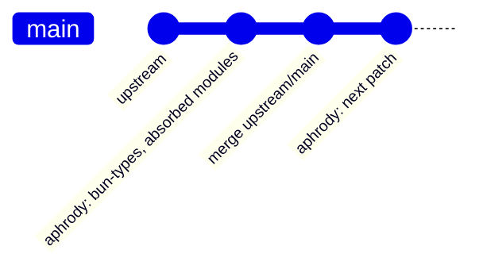

# Aphrody Bun Fork — Architecture, Synchronization & Optimization Hub

> **Repository Nexus**: [aphrody-labs/bun](https://github.com/aphrody-labs/bun)
> **Upstream Authority**: [oven-sh/bun](https://github.com/oven-sh/bun)
> **Organization**: `aphrody-labs`
> **Checkout Path**: `vendor/bun` (pin: `config/vendor.json`, not a Git submodule)
> **Fork Branch**: `main` (single and default branch: upstream `main` plus the Aphrody patches)
> **Sync & Drift Engine**: [`scripts/tools/vendor/bun_upstream_sync.ts`](../scripts/tools/vendor/bun_upstream_sync.ts)
> **PR & Issue Tracker Engine**: [`scripts/tools/vendor/bun_upstream_tracker.ts`](../scripts/tools/vendor/bun_upstream_tracker.ts)
> **Tracker Live Dashboard**: [BUN_UPSTREAM_TRACKER.md](BUN_UPSTREAM_TRACKER.md)

---

## 1. Fork Architecture: one branch

Since 2026-10-05 the fork has a single Aphrody working branch, **`main`** (also the GitHub default branch); the former
`yolo` integration branch was fast-forwarded into it and deleted. The fork also keeps hundreds of branches inherited from
`oven-sh/bun` and the prototype branch `aphrody`; none of them feeds the pin.

- `main` = upstream `oven-sh/bun:main` + the Aphrody patches, as commits on top (Tauri-aware type
  definitions `packages/bun-types/tauri.d.ts` (not in repo), modules resolved
  as built-ins, Rust native dependencies of the Linux linker).
- Upstream arrives by merge (`upstream/main` into `main`), never by rebase or force push.
- Optional `patches/bun/*.patch` files (root of this repo) are reapplied by the sync engine with
  `--apply --reapply-patches` when the fork checks fail after an upstream refactor.
- `bun-forge` (`yolo forge`, `config/bun-forge.json`) watches and builds `main`; `config/vendor.json` pins the
  qualified commit.

---

## 2. Git Remotes Matrix

| Remote Name | Target URL | Protocol | Access Level |
| :--- | :--- | :--- | :--- |
| **`origin`** | `git@github-dev:aphrody-labs/bun.git` | SSH / Rewritten HTTPS | Read / Write (`aphrody-labs`) |
| **`upstream`** | `https://github.com/oven-sh/bun.git` | HTTPS | Read-Only (Official Bun Core) |

---

## 3. Automation Toolchain & CLI Commands

The engines run directly with Bun (no `package.json` aliases):

| Command | Action | Description |
| :--- | :--- | :--- |
| `bun scripts/tools/vendor/bun_upstream_sync.ts --dry-run` | Sync Simulation | Reports commit distances and drift from local refs, without fetching or touching the working tree. Needs `upstream/main` and `main` (or `origin/main`). |
| `bun scripts/tools/vendor/bun_upstream_sync.ts --apply` | Auto-Sync Upstream | Fetches `upstream`, merges `upstream/main` into `main`, runs the fork checks, pushes `origin/main` (never forced). |
| `bun scripts/tools/vendor/bun_upstream_sync.ts --apply --auto-fix` | Drift Auto-Repair | Resolves conflicts on lockfiles and completions, re-applies Aphrody patches if diverged. |
| `bun scripts/tools/vendor/bun_upstream_tracker.ts` | Upstream Intelligence | Scans upstream PRs and issues for performance optimizations, memory fixes, and crashes. |

`vendor/bun` is a shallow, blobless checkout: without local refs, measure drift server side
(`aphrody git api "/repos/oven-sh/bun/compare/main...aphrody-labs:bun:main"`), then let the engine
fetch and merge (`--apply`, commits as `aphrody-dev`, never forced). A new `main` head is qualified by
`yolo forge build` on the build host before `config/vendor.json` moves.

---

## 4. Key Upstream Optimization Discoveries for Aphrody Fork

Based on automated upstream tracking:

1. **`BUN_JSC_numberOfGCMarkers=1` (Issue #44186)**:
   - Allocating workers contend on GC marking threads. For 4-8 worker agent fleets, capping GC markers halves wall time.
2. **`SQLITE_DEFAULT_MEMSTATUS=0` (Issue #44187)**:
   - Upstream SQLite reads contend on global mutex when memory status is tracked. Setting `SQLITE_DEFAULT_MEMSTATUS=0` unlocks concurrent worker reads.
3. **HTTP Head Buffer Optimization (Issue #44208)**:
   - Avoids quadratic buffer copy for non-upgrade HTTP requests in agent servers.
4. **Socket Drainage & TLS State Fix (PR #42351 & PR #44327)**:
   - Critical stability fix preventing orphaned WebSocket connections in high-frequency Obscura CDP interaction loops.

---

## 5. Pin Integrity

`vendor/bun` is not a Git submodule: `config/vendor.json` pins the qualified `main` commit, fetched by
`bun scripts/tools/vendor/fetch.ts`.
- Current pin: the `ref` of the `bun` entry in `config/vendor.json`
- Verification: `git -C vendor/bun rev-parse HEAD` against that `ref`
