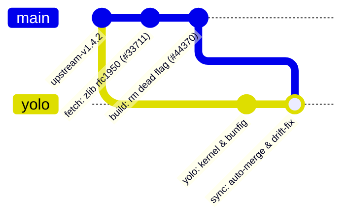

# Aphrody Bun Fork — Architecture, Synchronization & Optimization Hub

> **Repository Nexus**: [aphrody-labs/bun](https://github.com/aphrody-labs/bun)
> **Upstream Authority**: [oven-sh/bun](https://github.com/oven-sh/bun)
> **Organization**: `aphrody-labs`
> **Submodule Path**: [`vendor/bun`](../vendor/bun)
> **Active Fork Branch**: `yolo`
> **Pristine Upstream Branch**: `main`
> **Sync & Drift Engine**: [`scripts/vendor/bun_upstream_sync.ts`](../scripts/vendor/bun_upstream_sync.ts)
> **PR & Issue Tracker Engine**: [`scripts/vendor/bun_upstream_tracker.ts`](../scripts/vendor/bun_upstream_tracker.ts)
> **Tracker Live Dashboard**: [BUN_UPSTREAM_TRACKER.md](BUN_UPSTREAM_TRACKER.md)

---

## 1. Fork Architecture & Dual-Branch Protocol

1. **`main` (Pristine Upstream Mirror)**:
   - Tracks `upstream/main` directly.
   - Updated strictly via fast-forward or clean upstream merges.
   - Pushed continuously to `origin/main` (`aphrody-labs/bun:main`).
2. **`yolo` (High-Performance Fork Integration Branch)**:
   - Contains Tauri-aware type definitions: [`packages/bun-types/tauri.d.ts`](../vendor/bun/packages/bun-types/tauri.d.ts).
   - Optional `patches/bun/*.patch` files (root of this repo) are reapplied by `bun:drift-fix --reapply-patches` after upstream refactors.
   - Tracked and pushed to `origin/yolo` (`aphrody-labs/bun:yolo`).

---

## 2. Git Remotes Matrix

| Remote Name | Target URL | Protocol | Access Level |
| :--- | :--- | :--- | :--- |
| **`origin`** | `git@github-dev:aphrody-labs/bun.git` | SSH / Rewritten HTTPS | Read / Write (`aphrody-labs`) |
| **`upstream`** | `https://github.com/oven-sh/bun.git` | HTTPS | Read-Only (Official Bun Core) |

---

## 3. Automation Toolchain & CLI Commands

Root `package.json` provides native entry points:

| Command | Action | Description |
| :--- | :--- | :--- |
| `bun run bun:sync` | Auto-Sync Upstream | Fetches `upstream`, fast-forwards `main`, pushes to `origin/main`, merges into `yolo`, runs tests. |
| `bun run bun:drift-fix` | Drift Auto-Repair | Resolves conflicts on lockfiles, completions, and re-applies Aphrody patches if diverged. |
| `bun run bun:track` | Upstream Intelligence | Scans upstream PRs and issues for performance optimizations, memory fixes, and crashes. |
| `bun run bun:dry-run` | Sync Simulation | Reports commit distances, upstream drift status without modifying working tree. |

---

## 4. Key Upstream Optimization Discoveries for Aphrody Fork

Based on automated upstream tracking:

1. **`BUN_JSC_numberOfGCMarkers=1` (Issue #44186)**:
   - Allocating workers contend on GC marking threads. For 4-8 worker agent fleets, capping GC markers halves wall time.
2. **`SQLITE_DEFAULT_MEMSTATUS=0` (Issue #44187)**:
   - Upstream SQLite reads contend on global mutex when memory status is tracked. Setting `SQLITE_DEFAULT_MEMSTATUS=0` unlocks concurrent worker reads.
3. **HTTP Head Buffer Optimization (Issue #44208)**:
   - Avoids quadratic buffer copy for non-upgrade HTTP requests in agent servers.
4. **Socket Drainage & TLS State Fix (PR #42351 & PR #44327)**:
   - Critical stability fix preventing orphaned WebSocket connections in high-frequency Obscura CDP interaction loops.

---

## 5. Submodule Pointer Integrity

The monorepo tracks `vendor/bun` at the active `yolo` branch commit:
- Current Commit: see `git submodule status vendor/bun`
- Verification: `git submodule status vendor/bun`
