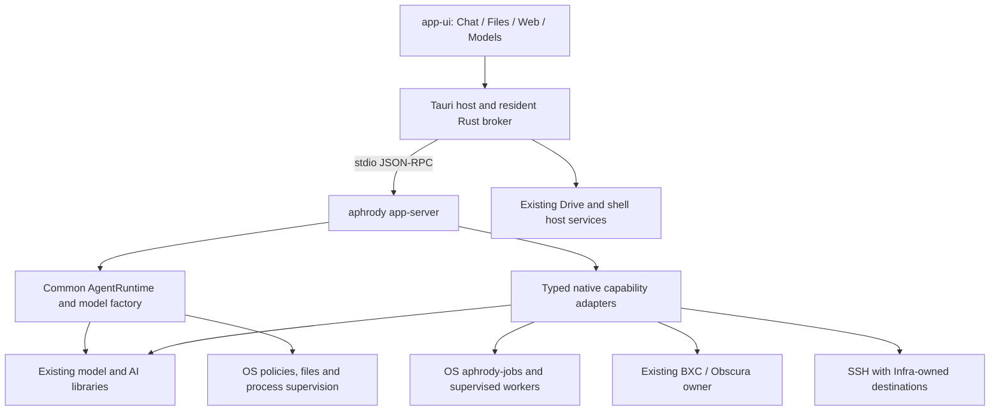

<!-- SPDX-License-Identifier: Apache-2.0 -->
# Architecture

**Host decision, 2026-09-29:** the [M3 multi-host plan](../../../m3/docs/plans/design/M3-MULTI-HOST-PLAN.md)
keeps Tauri as Aphrody's current and only qualified desktop host. The existing
Rust renderer crates remain reusable libraries; this architecture does not
target a second winit/wgpu desktop application. A GPU-specific host adapter
requires a measured workflow Tauri/web cannot meet and belongs to the same app.
The [agent delivery plan](../../plans/ai/PLAN.md) defines product and installed-host evidence.

Aphrody is a single Material Design 3 workstation combining a sovereign coding
agent, a VDFS explorer, web workflows and local models. The active implementation
sequence is [PLAN.md](../../plans/ai/PLAN.md); the UI interaction contract is
[aphrody-ui/docs/GUI.md](../../../m3/docs/reference/GUI.md).

## One product, explicit process boundaries

The diagram describes the target integration; several native adapters remain to
be implemented. The [baseline and capability matrix](../../plans/ai/PLAN.md#current-baseline)
identify actual implemented surfaces and remaining work.

`aphrody-ui` and `aphrody-os` never depend on `aphrody-ai` through Cargo. The UI
supervises the AI out of process through `aphrody app-server`. The target crash
recovery contract requires the broker to reject pending requests, keep UI state
usable, restart/reconnect and reconcile sessions after an agent-process failure.
Process separation provides crash containment; it does not by itself prevent
resource exhaustion or prove every host failure mode safe.

Within the resident AI process, call existing native library APIs directly. Use
supervised workers for operations whose isolation, runtime or hardware requires
them. Do not spawn the CLI for every UI action, recreate an HTTP/MCP hop for an
internal function, or route deterministic file/model operations through an LLM.
External MCP and A2A integrations remain valid protocol boundaries.

## Ownership

| Repository | Canonical responsibility |
| --- | --- |
| `aphrody-contracts` | Wire types, schemas and compatibility fixtures: app-protocol, agent-proto, A2A |
| `aphrody-ai` | Agent runtime/tools, provider clients, model management/inference, embeddings/RAG, OCR/vision/voice, training, AI MCP/A2A, app-server, unified CLI and unified Aphrody/Dragon Ball agent plugin |
| `aphrody-os` | System primitives, process supervision/Job Objects, policy enforcement, secrets, SQLite jobs, kernel and WinClean integration |
| `aphrody-web` | Obscura/V8, BXC browsing/extraction and web integrations |
| `aphrody-shell` | Nushell integration, PTY and terminal behavior |
| `aphrody-ui` | Tauri application, app-ui, M3 tokens/components and Drive presentation/runtime |
| `aphrody-infra` | Hosts, services, proxy routes, deployment/release and generated ecosystem discovery |
| `aphrody-native`, `aphrody-compat` | Existing native and compatibility facilities consumed by their declared owners |

The actual dependency graph and feature names are in Cargo manifests and the
[generated ecosystem catalogue](../../ecosystem/ECOSYSTEM.md).
Repository/crate counts are snapshots, not design constraints. No copied sibling
implementation, reverse AI dependency, duplicate infrastructure registry or second
job queue is introduced by this architecture.

## Workstation shell and object actions

`aphrody-ui/m3/packages/app-ui` is the single packaged frontend owner. The user reports
that Spacedrive shell/explorer components have been consolidated there and
`drive/packages/interface` excluded from Bun workspaces. Maintain that completed
consolidation; release evidence still has to identify the built revision/artifact.

One main window contains `SpacesSidebar`, `TabBar` and the current zone:

- **Chat** (`/`, `/chat`): Codex-style item timeline/composer, tool outputs,
  reviewable changes, inline approvals, clean greeting and interactive pet.
- **Files** (`/explorer`): VDFS grid/list/columns, QuickPreview, file actions and
  contextual inspector. The inspector appears for selection here and is hidden
  by default in the other zones.
- **Web** (`/web`, `/crawlers`): browsing and extraction through existing owners.
- **Models** (`/models`): hardware-aware model lifecycle with verified resumable
  downloads and actual execution readiness.

OCR, transcription, indexing and training start from selected objects and produce
background jobs. Their results return to those objects and relevant conversation
items. Shared job progress/history is contextual; implementation internals and raw
JSON do not become product pages. M3 accessibility preserves at least 18 px text,
strong contrast, static focus and screen-reader/keyboard support.

## Runtime and transports

### Implemented foundation

The CLI and app-server share the agent runtime, model factory and profile system.
Provider clients, streaming, tool execution, local inference and persistent
rollouts already exist. `exec --image` and `--output-schema` are implemented.
The app-server implements stdio and HTTP JSON-RPC, SSE `/events` and polling;
claiming that SSE must be created would be incorrect.

Current transport weaknesses are integration issues: the HTTP handler holds a
server-wide lock across asynchronous work, multiple delivery surfaces drain a
shared notification queue, and tool events are projected with insufficient payloads.
The plan calls for lock isolation, independent consumers and complete typed items.

### Target request lifecycle

1. Tauri resolves and supervises the bundled/configured agent binary. A persistent
   broker owns stdin/stdout, correlation and process lifecycle.
2. The client sends `initialize`, receives negotiated information and sends
   `initialized`. Only then does it request models, threads or capabilities.
3. Short operations return promptly. Long work returns a turn/job handle and emits
   progress/typed items through the existing connection.
4. Server-issued requests, including approvals, use a separate response path.
   Replies preserve the original request ID and do not create a new client request.
5. EOF/crash fails pending requests with a meaningful error; recovery uses a fresh
   connection generation, handshake and authoritative snapshots/replay as supported.

The broker must support multiple subscribers without replacing a thread's existing
view channel or duplicating global/thread events. Request budgets depend on the
operation. Holding a connection lock over a long handshake/replay or applying one
600-second timeout to every operation is not the desired contract.

## Contract and state model

`aphrody-contracts` owns wire types and fixtures. The transport follows the declared
Codex app-server compatibility subset; it is not an assertion that every upstream
method works. ACP is a separate integration protocol, and its Rust SDK does not
replace the existing app-server wire contract. Add an ACP adapter only for a real
consumer, through its existing owner, without renaming the app-server transport.

The existing Aphrody extensions are `aphrody/status`,
`aphrody/rag/search`, `aphrody/rag/context`, `aphrody/rag/status`,
`aphrody/llama/status` and `aphrody/train/status`. Broad job/model/OCR/train-run/web
request families are proposed adapters, not implemented methods merely because a
corresponding library exists. Feature discovery must reflect actual support and
readiness; a static status print is not a health probe.

UI state is normalized by thread, turn and item identifiers. Tool calls carry their
own identity, arguments, output/artifacts and final status. Do not match tools by
name, merge deltas into an arbitrary last message or claim success from a missing
payload. Reconstruct state from the authoritative snapshot after reconnect.

Per-subscriber queues must be bounded. Replay sequence/cursor and subscription
extensions require explicit schema/version negotiation before use. Use idempotent
reducers for replayed IDs/sequences; do not invent sequence fields or deduplicate
legitimate repeated text heuristically. When a peer lacks replay, fetch snapshots
and expose a recoverable gap rather than silently invent completeness.

Rollout persistence already uses a bounded writer with backpressure and propagated
flush/fsync failures. Turn completion waits for its durability barrier. Preserve
these properties while optimizing streaming. A UI render batch may coalesce deltas;
approvals, durable mutations and terminal results must remain recoverable.

## Native capability and job integration

Keep the business implementation in its current owner. An app-server adapter
validates typed inputs, authorizes access, invokes that owner and publishes typed
progress/results. Helpers such as codecs or embedding math remain internal.

Long-running work uses `aphrody-jobs` in `aphrody-os` for durable identity and
lifecycle, with owner-specific workers for models, indexing, OCR, Whisper, training
and crawlers. Reuse its real APIs and state model; extending that owner is preferable
to adding a second SQLite queue. Contracts/UI need job adapters before they can
truthfully expose a unified job view.

Artifact messages carry authorized references and useful metadata. Large audio,
images, model blobs and repeated file contents do not flow through every token
event. Secrets stay in native credential facilities; URLs/paths and remote
capabilities are resolved through their existing owners, including Infra for hosts.

Models are long-lived resources with observable load state. Download verification,
resumption, VRAM/CPU feature detection and error handling use actual observations.
Coordinate training and inference admission so that a background job cannot
silently evict the active coding model. Read-only tools may run concurrently where
safe; workspace mutations and shared resources need explicit ordering.

## Policies, approvals and cancellation

The first local development slice can use explicitly selected full access.
Restricted modes remain rejected until they are enforced end to end. Use the canonical `danger-full-access` wire value. The legacy spelling alias
is recorded in the GUI contract; verify the actual exchange rather than maintaining
frontend-only aliases.

A policy is effective only if every actual tool path enforces it. AI shell
execution must use the OS enforcement path; sandbox setup errors must propagate.
A process group alone is not filesystem/network confinement. Patch and file
operations must validate permitted roots, absolute paths, traversal and platform
path behavior. OS support is qualified per platform.

Approval requests carry the operation, scope and original ID; decisions are applied
exactly once. Session approval is labelled as such until a real persistent project
policy exists. Noninteractive execution uses its explicit profile and fails cleanly
when required approval cannot be obtained.

Cancellation propagates from UI through broker/server/runtime to providers and
active tools/workers. Terminate and reap owned process trees; report real state if
native/GPU work can stop only at a safe boundary. User-visible interruption is not
complete merely because an acknowledgement was sent.

## Performance and observability

The latency targets and measurement protocol live only in
[PLAN.md](../../plans/ai/PLAN.md#latency-budgets). Keep the agent and required workers resident,
wake streams on events, avoid long-held global locks, virtualize histories and bound
all queues. Model download/load and inference are measured separately from IPC/UI.

Collect trace IDs and timing in diagnostics/evidence, with secrets redacted. The
main interface displays task state and results, not protocol telemetry. Measure
cross-process time with compatible clocks and retain workload/platform context.
No zero-latency or benchmark claim is made by this document.

## Upstream reuse and distribution

`thirdparty/codex` is the pinned Apache-2.0 source reference. The extraction map in
[THIRD_PARTY_CODEX.md](../../reference/ai/THIRD_PARTY_CODEX.md) identifies reusable parser/contracts
and architecture references with their destination owners. Importing the entire
upstream runtime would duplicate existing owner responsibilities.

An OSS product claim applies to the complete distributed source/dependency closure.
Drive-derived sources retain their license after a directory move; FSL lineage
requires a deliberate distribution decision. Keep notices, upstream provenance,
model-weight terms and the supported-platform matrix explicit. A clean installed
workflow and public reproducible sources are release gates, not implied by source
presence or successful compilation of one crate.
