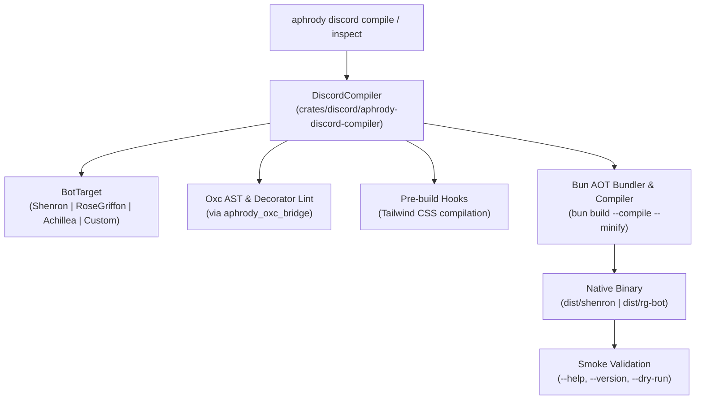

<!-- SPDX-License-Identifier: Apache-2.0 -->

# Discord Bot Compiler Architecture (`aphrody-discord-compiler`)

This document details the architecture, design decisions, and runtime mechanisms of the Discord bot compilation system in the Aphrody monorepo.

---

## 1. Motivations and Design Goals

Running Discord bots in production using standard Node.js or raw interpreted TypeScript environments involves significant operational friction:
1. **Host Dependency Bloat**: Maintaining thousands of dependencies under `node_modules` on production servers.
2. **Cold Start & Transpilation Latency**: JIT transpile-and-load overhead on startup for hundreds of command modules.
3. **Runtime Drift**: Divergence between local developer Bun/Node versions and server runtimes.
4. **Decorator Resolution Fragility**: TypeScript experimental decorators (`reflect-metadata`, `tsyringe`, `discordx`) require strict evaluation sequencing that often fails under standard bundling.

The Aphrody Discord Compiler solves these issues by producing **single self-contained native executable binaries** (`dist/shenron` (not in repo) (generated or machine-local artifact; presence depends on the build host), `dist/rg-bot` (not in repo) (generated or machine-local artifact; presence depends on the build host)) that embed:
- The optimized Bun engine (compiled for target architecture, e.g. Linux x64)
- All AOT-compiled application bytecode and NPM dependencies
- Embedded assets (fonts, icons, styling)
- Zero external runtime requirement: no Bun binary and no `node_modules` needed on target machines.

---

## 2. Rust Crate Architecture (`crates/discord/aphrody-discord-compiler` (not in repo) (retired source path; retained as historical evidence))

The core orchestrator is implemented in Rust as `aphrody-discord-compiler`, a first-party workspace member located in `crates/discord/aphrody-discord-compiler` (not in repo) (retired source path; retained as historical evidence).



### Core Rust Structures

- **`BotTarget`**: Enum identifying supported targets:
  - `BotTarget::Shenron`: Root `shenron:apps/bot`, entry `src/entry-standalone.ts`, output `dist/shenron` (not in repo) (generated or machine-local artifact; presence depends on the build host).
  - `BotTarget::RoseGriffon`: Root `iecode/apps/rg/bot`, entry `src/entry-standalone.ts`, output `dist/rg-bot` (not in repo) (generated or machine-local artifact; presence depends on the build host).
  - `BotTarget::Achillea`: Root `apps/rg/achillea-bot` (not in repo), entry `src/main.ts`, output `dist/achillea` (not in repo) (generated or machine-local artifact; presence depends on the build host).
  - `BotTarget::Custom(PathBuf)`: Arbitrary external Discord bot.
- **`CompilerOptions`**:
  ```rust
  pub struct CompilerOptions {
      pub minify: bool,               // default: true
      pub sourcemap: bool,            // default: true
      pub smoke_check: bool,          // default: true
      pub target_triple: Option<String>, // e.g. bun-linux-x64, bun-windows-x64
      pub pre_build: bool,            // default: true
  }
  ```
- **`BotInspection`**:
  Performs pre-flight inspection of bot directories, scanning TypeScript commands via `aphrody_oxc_bridge` to ensure AST integrity and decorator validity without starting a JavaScript process.
- **`DiscordCompiler`**:
  Finds the monorepo root (detecting `bun.lock` and `Cargo.toml`), resolves the active `bun` binary, executes pre-build hooks, invokes `bun build --compile`, and executes immediate smoke verification of the resulting binary.

### CLI Integration (`crates/infra/aphrody`)

The Aphrody CLI exposes the compiler through dedicated subcommands in `crates/infra/aphrody-command/src/discord_cmd.rs`:

```bash
# Compile both Shenron and RG bots with smoke testing
aphrody discord compile all --smoke

# Compile a specific target
aphrody discord compile shenron
aphrody discord compile rg

# Inspect bot configuration, AST decorators, and commands count
aphrody discord inspect shenron
aphrody discord inspect rg --json

# Run comprehensive monorepo verification gate
aphrody discord verify
```

Alternatively, the Bun-native script wrapper is accessible via:
```bash
bun run discord:compile [shenron|rg|all] [--smoke]
```

---

## 3. Resolving AOT Bundling Challenges

Compiling complex DiscordX applications into standalone binaries presented three architectural hurdles, each resolved with dedicated mechanisms.

### 3.1 Reflection Timing and `entry-standalone.ts`

**The Problem**:
DiscordX and `tsyringe` rely heavily on `reflect-metadata` for decorator reflection (`@Discord`, `@Slash`, `@On`, `@Guard`). When bundling to a standalone binary, JavaScript modules are bundled into a single file or bundle chunk. If `reflect-metadata` is imported inside a regular module that has circular references or is hoisted after decorator evaluation, the JavaScript engine executes decorators with `Reflect.defineMetadata` undefined, crashing with:
```
TypeError: undefined is not an object (evaluating 'descriptor.value')
```

**The Solution**:
Each bot utilizes a dedicated compilation entrypoint: `src/entry-standalone.ts`.

```typescript
// 1. Handle fast-path CLI flags synchronously before anything is loaded
if (process.argv.includes("--help") || process.argv.includes("-h")) {
	console.log(`Shenron Discord Bot + Public API`);
	console.log(`Usage: shenron [options]\n`);
	console.log(`Options:`);
	console.log(`  -h, --help     Show this help message`);
	console.log(`  -v, --version  Show version and runtime info`);
	console.log(`  --dry-run      Validate configuration and exit`);
	process.exit(0);
}

if (process.argv.includes("--version") || process.argv.includes("-v")) {
	console.log(`@shenron/bot v1.0.0 (Bun ${typeof Bun !== "undefined" ? Bun.version : process.version})`);
	process.exit(0);
}

// 2. Synchronously import reflection polyfill FIRST
import "reflect-metadata";

// 3. Asynchronously evaluate the main application index
await import("./index");
```

This guarantees:
1. Fast-path CLI queries (`--help`, `--version`) return in milliseconds without initializing Discord or databases.
2. `reflect-metadata` is loaded into the global scope before `index.ts` and its downstream decorators are evaluated.

### 3.2 Dynamic Directory Traversal vs. Static Loader Table (`src/modules.ts`)

**The Problem**:
In `@rosegriffon/bot`, command modules were historically loaded by reading the file system dynamically (`fs.readdirSync`) and importing each `.ts` file.
When `bun build --compile` analyzes code, it cannot follow dynamic path string concatenations like `import(`./commands/${category}/${file}`)`. As a result, none of the command files were bundled into the binary, resulting in an empty bot.

**The Solution**:
Introduction of a static module loader registry in `iecode/apps/rg/bot/src/modules.ts`:

```typescript
export const MODULE_LOADERS: Record<string, () => Promise<unknown>> = {
	// Azalée profile
	"commands/azalee-jeu.ts": () => import("./commands/azalee-jeu"),
	"commands/cpk.ts": () => import("./commands/cpk"),
	"commands/cdn.ts": () => import("./commands/cdn"),
	"commands/x.ts": () => import("./commands/x"),
	"commands/validation-annonce.ts": () => import("./commands/validation-annonce"),

	// Rose Griffon profile
	"commands/achillea.ts": () => import("./commands/achillea"),
	"commands/administration/racine.ts": () => import("./commands/administration/racine"),
	"commands/administration/moderation.ts": () => import("./commands/administration/moderation"),
	// ... 40+ additional commands and events
	"events/ready.ts": () => import("./events/ready"),
	"events/memberEvents.ts": () => import("./events/memberEvents"),
};
```

This architecture achieves two vital objectives:
1. **AOT Bundling Visibility**: Bun's static bundler traces every `() => import(...)` and compiles all 50+ command modules into the binary.
2. **Dynamic Runtime Profile Dispatch**: At runtime, the bot selectively executes only the loaders matching the configured profile (`rg` vs `azalee`) via `iecode/apps/rg/bot/src/index.ts`.

### 3.3 Logger Worker Thread Fallback in Standalone Mode

**The Problem**:
Libraries like `pino` and `pino-pretty` spawn `node:worker_threads` to handle asynchronous log formatting. In a compiled Bun binary, worker threads cannot resolve script paths located within Bun's virtual embedded filesystem (`$bunfs`), resulting in fatal thread spawn crashes.

**The Solution**:
In `@aphrody/discord-kit/src/runtime.ts`:

```typescript
export function isCompiledBinary(): boolean {
	const isBun = typeof Bun !== "undefined";
	if (!isBun) return false;
	const exec = process.execPath || "";
	return (
		!exec.endsWith("/bun") &&
		!exec.endsWith("/bun.exe") &&
		!exec.includes("node_modules")
	);
}
```

In `shenron:apps/bot/src/lib/logger.ts`, logger initialization checks `isCompiledBinary()`. When running as a compiled standalone binary, it bypasses thread workers and writes directly to stdout/stderr with formatting, ensuring crash-free operation.

---

## 4. Compilation Results and Binary Profiles

| Property | Shenron Bot (`dist/shenron` (not in repo) (generated or machine-local artifact; presence depends on the build host)) | Rose Griffon Bot (`dist/rg-bot` (not in repo) (generated or machine-local artifact; presence depends on the build host)) |
| :--- | :--- | :--- |
| **Source Directory** | `shenron:apps/bot` | `iecode/apps/rg/bot` |
| **Entrypoint** | `src/entry-standalone.ts` | `src/entry-standalone.ts` |
| **Pre-build Step** | Tailwind CSS generation for web dashboard | None |
| **Bundled Modules** | 2,470 modules | 959 modules |
| **Binary Size** | ~151.6 MB | ~144.9 MB |
| **Compilation Time** | ~26s | ~4.4s |
| **Output Type** | Standalone ELF Executable (x86_64 Linux) | Standalone ELF Executable (x86_64 Linux) |
| **Smoke Check** | `--help` → clean exit 0 | `--help` → clean exit 0 |
| **Host Prerequisites** | Zero (`glibc` only) | Zero (`glibc` only) |

---

## 5. Verification Commands

```bash
# Compile and smoke-test all binaries
bun run discord:compile all --smoke

# Run full monorepo verification (catalog, kit, messaging, bot tests, compile)
bun run discord:verify --compile
```
