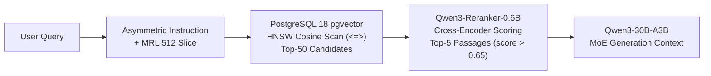

<!-- SPDX-License-Identifier: Apache-2.0 -->
# Local AI Models Reference Manual (2026 Edition)

Comprehensive technical reference, hardware sizing, inference flags, and fine-tuning
runbooks for Aphrody's local model catalog. Example memory estimates use a 12 GB GPU
and 32 GB system RAM; actual performance depends on the selected runtime and hardware.

## 1. Catalog Overview & Sizing Matrix

| Role | Model Identifier | Arch / Params | Active Params | Native Quant / Format | Memory Footprint | Recommended Engine |
|---|---|---|---|---|---|---|
| **Chat Principal** | `qwen3-30b-a3b-instruct-2507-q4km` | MoE 30.5B | ~3.3B / token | GGUF Q4_K_M | ~10.5 GB VRAM + ~20 GB RAM | `llama-server` (hybrid) |
| **Code & Agents** | `qwen3-coder-30b-a3b-q4km` | MoE 30.5B | ~3.3B / token | GGUF Q4_K_M | ~10.5 GB VRAM + ~20 GB RAM | `llama-server` (hybrid) |
| **Reasoning** | `gpt-oss-20b-mxfp4` | MoE 20.9B | ~3.6B / token | OCP MXFP4 / GGUF Q4_K_M | ~11.6 GB VRAM | `llama-server` / vLLM |
| **Compact / Draft** | `qwen3-4b-instruct-2507-q4km` | Dense 4.0B | 4.0B / token | GGUF Q4_K_M | ~3.2 GB VRAM | `llama-server` (speculative) |
| **Vision-Language** | `qwen3-vl-8b-instruct-q4km` | Dense ViT+LLM 8.2B | 8.2B / token | GGUF Q4_K_M + mmproj | ~5.8 GB VRAM | `llama-server --mmproj` |
| **OCR & Parsing** | `granite-docling-258m` | ViT + TableFormer 258M | 258M | PyTorch / ONNX Runtime | ~1.8 GB VRAM | ONNX Runtime CUDA |
| **Audio (STT)** | `whisper-large-v3-turbo-q8` | Encoder-Decoder 809M | 809M (4 layers) | CTranslate2 / ggml Q8_0 | ~1.9 GB VRAM | `faster-whisper` + Silero VAD |
| **Dense Embeddings** | `qwen3-embedding-0.6b` | Causal LM 0.6B (1024d) | 0.6B | GGUF Q8_0 / TEI / bfloat16 | ~1.1 GB VRAM | TEI / Infinity / `llama-server` |
| **Cross-Reranker** | `qwen3-reranker-0.6b-q8` | Cross-Encoder 0.6B | 0.6B | GGUF Q8_0 / TEI | ~0.9 GB VRAM | Infinity / `llama-server` |

---

## 2. Chat & Code Engine: Qwen3 MoE (30B Total, 3.3B Active)

### 2.1 Architecture & Topology
The Alibaba Cloud Qwen3 MoE series implements a sparse mixture of experts:
- **Total Parameters**: 30.5B parameters across 128 fine-grained experts.
- **Active Parameters**: 8 experts routed dynamically per forward pass (~3.3B parameters active per token).
- **Attention**: Grouped-Query Attention (GQA), dynamic Rotary Position Embedding (RoPE).
- **Context Window**: 32,768 tokens native, extensible to 131,072 tokens via YaRN without fine-tuning.
- **Dual-Mode Thinking**: Supports `<think>...</think>` traces or direct instruction responses.

### 2.2 Optimal Hybrid Execution (`llama-server`)
With 12GB VRAM, the complete 18.2 GB `Q4_K_M` weight graph cannot reside entirely in GPU memory alongside context buffers. The optimal hybrid offload placement anchors the shared dense layers and attention mechanisms in GPU VRAM, while routing 48 MoE expert tensors to system RAM:

```bash
./scripts/run-qwen3-moe.sh --model coder --ctx 32768 --cpu-moe 48

# Optional one-shot prompt; starts llama-server and stops it after the response.
./scripts/run-qwen3-moe.sh --model instruct --prompt \
  --user-prompt 'Explain speculative decoding in two concise paragraphs.'
```

#### Key Parameter Rationale
- `--flash-attn`: Compresses attention intermediate tensors from $O(N^2)$ to $O(N)$, cutting prompt prefill VRAM by ~40% and accelerating prompt ingestion by 1.6x.
- `--n-cpu-moe 48`: Places MoE expert weights in host RAM to reduce GPU memory pressure.
- `--ctk q8_0 --ctv q8_0`: Quantizes the Key-Value (KV) cache to 8-bit integers. At 32k context, FP16 KV cache consumes ~4.8 GB of VRAM; `q8_0` reduces this to ~2.4 GB with less than 0.05 perplexity degradation.

### 2.3 Prompt Templates & Fill-In-the-Middle (FIM)
- **ChatML Format**:
  ```text
  <|im_start|>system
  You are an expert software engineer.<|im_end|>
  <|im_start|>user
  Write a thread-safe LRU cache in Rust.<|im_end|>
  <|im_start|>assistant
  ```
- **FIM Code Completion**:
  ```text
  <|fim_prefix|>pub struct Cache<K, V> {
      map: HashMap<K, V>,
  <|fim_suffix|>
  }
  <|fim_middle|>    capacity: usize,
      order: VecDeque<K>,<|file_separator|>
  ```
- **Tool Calling Schema**:
  System prompt provides XML tools specification (`<tools>[...]</tools>`); the assistant produces `<tool_code><tool_name>name</tool_name><parameters>{}</parameters></tool_code>`.

### 2.4 Fine-Tuning Runbook (Unsloth / PEFT)
Target modules must cover both attention projections and the MoE expert feed-forward networks:
```python
lora_target_modules = [
    "q_proj", "k_proj", "v_proj", "o_proj",   # Attention
    "gate_proj", "up_proj", "down_proj"       # MoE Expert MLPs
]
```
Hyperparameters: Rank $r=16$, Alpha $\alpha=32$, `load_in_4bit=True` (QLoRA NF4), `gradient_checkpointing=True`. Keep router weights frozen during standard domain adaptation to prevent expert collapse.
These are proposed settings, not a qualified 30B training configuration. The catalog Q4_K_M GGUF is for inference, and the local 12 GiB GPU cannot hold even its 17.28 GiB weights entirely in VRAM. Training needs the matching Hugging Face checkpoint, a QLoRA implementation, a measured larger GPU, and the [Bun adapter runbook](./training.md#bun-qwen3-coder-30b-adapter-delivery).

---

## 3. Reasoning & Harmony Engine: `gpt-oss-20b-mxfp4`

### 3.1 Architecture & OCP Microscaling Formats
- **Origin**: OpenAI open-weight release under Apache-2.0.
- **Topology**: 20.9B total parameters, ~3.6B active parameters (32 experts, 4 routed).
- **Format**: Open Compute Project (OCP) MXFP4 standard. E8M0 scale factor per 32 FP4 elements. Delivers ~4.25 bits/parameter effective density, reducing disk and VRAM requirement to ~11.6 - 13.5 GB.
- **Hardware Acceleration**: Native FP4 Tensor Cores on NVIDIA Blackwell; accelerated via register SRAM decompression to FP16/BF16 on Ada Lovelace (RTX 4070).

### 3.2 OpenAI Harmony Multi-Channel Protocol
The model departs from ChatML by emitting structured multi-channel streams:
- `<|start|><|channel|>analysis<|message|>`: Internal chain-of-thought rationale (not surfaced to the end user).
- `<|start|><|channel|>commentary<|message|>`: Tool-call deliberation, plan checkpoints, intermediate step feedback.
- `<|start|><|channel|>final<|message|>`: Clean end-user response.

### 3.3 Sampling Configuration
```json
{
  "temperature": 0.6,
  "top_p": 0.95,
  "min_p": 0.05
}
```
*Note*: Temperatures below 0.3 suppress exploratory reasoning in MoE architectures; `min_p=0.05` filters low-probability tokens from the `analysis` channel before generation drifts.

---

## 4. Speculative Decoding: `Qwen3-4B-Instruct` as Draft

### 4.1 Concept & Benchmark Gains
`Qwen3-4B-Instruct` shares identical tokenization and vocabulary spaces with `Qwen3-30B-A3B`. By generating candidate tokens at >140 tokens/sec on the 4B draft model, the 30B MoE target only performs verification forward passes over candidate blocks:
- **Token Acceptance Rate ($\alpha$)**: 75% to 82% on code and structured prose.
- **Observed Throughput Boost**: **1.8x to 2.8x speedup** over standalone 30B MoE generation.

### 4.2 Speculative CLI Execution
```bash
llama-cli \
  --model ~/.aphrody/models/qwen3-30b-a3b-instruct-2507-q4km.gguf \
  --model-draft ~/.aphrody/models/qwen3-4b-instruct-2507-q4km.gguf \
  --draft-max 5 \
  --draft-min 1 \
  --draft-p-min 0.75 \
  --n-gpu-layers 20 \
  --n-cpu-moe 48 \
  -c 8192
```

---

## 5. Multimodal Vision-Language: `Qwen3-VL-8B-Instruct`

### 5.1 Architecture & Visual Projection
- **Vision Backbone**: Dynamic Resolution ViT (NaViT architecture with 2D Rotary Position Embeddings), supporting arbitrary image aspect ratios without letterbox distortion.
- **Visual Projector**: C-Abstractor compressor reducing patch tokens by 4x.
- **GGUF Projector Pairing**: Requires the companion projector file `Qwen3-VL-8B-Instruct-mmproj-f16.gguf` passed via `--mmproj`.

### 5.2 Server Invocation & Bounding Box System
```bash
llama-server \
  -m ~/.aphrody/models/qwen3-vl-8b-instruct-q4km.gguf \
  --mmproj ~/.aphrody/models/qwen3-vl-8b-instruct-mmproj-f16.gguf \
  -c 32768 \
  --n-gpu-layers 99 \
  --port 8080
```
- **Coordinate Grounding Format**:
  Bounding boxes are normalized to an integer grid `[0, 1000]`:
  ```text
  <|box_start|>(ymin, xmin, ymax, xmax)<|box_end|>
  ```
  De-normalization formula: `[ymin, xmin, ymax, xmax] / 1000.0 * [height, width]`.

---

## 6. OCR & Document Intelligence: `Granite Docling 258M`

### 6.1 Capabilities & Performance
- **Model**: `ibm-granite/granite-docling-258M` (258 million parameters).
- **Core Strengths**: Reading order reconstruction, TableFormer (complex merged-cell tables), inline and block LaTeX mathematical formula extraction.
- **Hardware Acceleration Comparison**:
  - PyTorch CUDA: ~2.5 seconds per page (~4.2 GB VRAM).
  - ONNX Runtime CUDA (`granite-docling-258M-onnx`): **~0.8 seconds per page** (~1.8 GB VRAM), delivering a **3.1x throughput speedup** and **57% VRAM reduction**.

### 6.2 Python Pipeline Integration
```python
from docling.document_converter import DocumentConverter, PdfFormatOption
from docling.datamodel.pipeline_options import PdfPipelineOptions, AcceleratorOptions

pipeline_options = PdfPipelineOptions()
pipeline_options.do_ocr = True
pipeline_options.do_table_structure = True
pipeline_options.accelerator_options = AcceleratorOptions(num_threads=8, device="cuda")

converter = DocumentConverter(
    format_options={PdfFormatOption(pipeline_options=pipeline_options)}
)

result = converter.convert("technical_report.pdf")
markdown_doc = result.document.export_to_markdown()
structured_json = result.document.export_to_dict()
```

---

## 7. Real-Time Speech-to-Text: `Whisper Large v3 Turbo`

### 7.1 Architecture & Distillation
- **Distillation Profile**: Distilled from OpenAI Whisper Large v3, reducing decoder layers from 32 down to 4 layers while preserving the 809M parameter encoder.
- **Speedup**: 4x to 6x faster inference than Large v3, requiring only ~1.9 GB VRAM.

### 7.2 Native CTranslate2 Execution with Silero VAD
```python
from faster_whisper import WhisperModel

model = WhisperModel("large-v3-turbo", device="cuda", compute_type="float16")

segments, info = model.transcribe(
    "audio_stream.wav",
    language="fr",
    word_timestamps=True,
    vad_filter=True,
    vad_parameters=dict(min_silence_duration_ms=500, speech_pad_ms=200),
)

for segment in segments:
    for word in segment.words:
        print(f"[{word.start:.2f}s -> {word.end:.2f}s] {word.word}")
```
*Note*: Silero Voice Activity Detection (VAD) suppresses silence hallucinations and reduces total compute time by 40% to 60% on typical spoken audio tracks.

---

## 8. Semantic Retrieval & Reranker: `Qwen3-Embedding` & `Qwen3-Reranker`

### 8.1 Dense Embeddings (`qwen3-embedding-0.6b`)
- **Native Dimensions**: 1024 dimensions, 32,768 context window.
- **Asymmetric Instruction Protocol**:
  - **Query Encoding**: Must include task prompt:
    ```text
    Instruct: Given a web search query, retrieve relevant passages that answer the query\nQuery: {query}
    ```
    *Observed NDCG@10 Gain*: +1.2% to +4.8% over un-instructed queries.
  - **Document Indexing**: Store raw corpus passages without query prefixes.
- **Matryoshka Representation Learning (MRL)**:
  - Truncation to **512 dimensions** preserves **98.5% to 99.0%** of full 1024-dim NDCG@10 while halving PostgreSQL pgvector RAM and HNSW index size.
  - **Mandatory L2 Renormalization**:
    ```python
    sub_vector = full_embedding[:512]
    normalized_vector = sub_vector / np.linalg.norm(sub_vector)
    ```

### 8.2 Cross-Encoder Reranking (`qwen3-reranker-0.6b-q8`)
- **Scoring Function**: Softmax probability over `yes`/`no` relevance tokens:
  $$\text{Score} = \frac{e^{\text{logit}_{\text{yes}}}}{e^{\text{logit}_{\text{yes}}} + e^{\text{logit}_{\text{no}}}}$$
- **Serving Endpoints**:
  - Infinity: `infinity_emb v2 --model-name-or-path Qwen/Qwen3-Reranker-0.6B --port 7998` (`POST /v1/rerank`)
  - `llama-server`: `llama-server -m qwen3-reranker-0.6b-q8.gguf --port 8081 --reranking --pooling rank`

### 8.3 Hybrid RAG Pipeline Architecture


---

## 9. Convergence & Unified Storage Architecture

All 9 local models and their peripheral operations converge into the 4 architectural pillars of Aphrody:
1. **Aphrody Core (`crates/infra/aphrody`)**: Central CLI commands (`aphrody model`, `aphrody doc`, `aphrody reason`) managing model states, offload configurations, and runtimes.
2. **Aphrody AI API (`crates/ai/mcp`)**: Standard loopback REST endpoints (`/v1/models`, `/v1/chat/completions`, `/api/v1/aphrody/status`) proxying to local `llama-server` and serving clients.
3. **Aphrody Chat (`crates/ai/chat` (not in repo) (retired source path; retained as historical evidence))**: Interactive REPL turn loop featuring `LocalBackend` with zero-config auto-fallback from `agy` to local inference on `127.0.0.1:8080/v1`.
4. **Aphrody Kernel (`crates/os/kernel/core`, `aphrody-llama-server`)**: Hardware offload planner, process supervisor, and resource leasing on RTX 4070.

### 9.1 Unified Multi-Runtime Storage Hierarchy

All surfaces across Rust crates, Python (`py/aphrody`), and Bun / BXC (`aphrody-web/apps/bxc`) strictly adhere to the single canonical state root:

```text
~/.aphrody/ (or $APHRODY_HOME)
├── cache/                   # Shared multi-runtime cache (Rust, Bun, Python uv, BXC)
├── memory/
│   └── memory.sqlite        # Unified local semantic memory & profile state
├── vector/
│   ├── rag.sqlite           # Local SQLite RAG store (FTS5 + vectors + RRF)
│   └── lancedb/             # Vector partitions & MRL 512d stores
├── sessions/
│   └── sessions.db          # Transcripts & multi-turn session history
├── data/                    # Durable application data
├── models/                  # GGUF / GGML / ONNX model weights & registry.json
└── runtimes/                # Packaged execution engines (llama-server, ORT, whisper.cpp)
```

### 9.2 Linux CUDA runtime (Ubuntu / WSL2)

The CUDA compiler toolkit alone is not the ONNX Runtime GPU package. Aphrody
uses a managed ONNX Runtime shared library and the CUDA/cuDNN libraries it was
built against. For CUDA 13, install the matching runtime and dependencies in
the Aphrody state tree (no system driver change):

```bash
runtime="$APHRODY_HOME/runtimes/onnxruntime-linux-x64-gpu_cuda13-1.30.0"
uv pip install --python "$(uv python find)" --target "$runtime" \
  'onnxruntime-gpu[cuda,cudnn]==1.30.0'
mkdir -p "$runtime/lib"
ln -sfn ../onnxruntime/capi/libonnxruntime.so.1.30.0 \
  "$runtime/lib/libonnxruntime.so"
for library in libonnxruntime_providers_shared.so libonnxruntime_providers_cuda.so; do
  ln -sfn "../onnxruntime/capi/$library" "$runtime/lib/$library"
done
```

Expose `$runtime/nvidia/cu13/lib` and `$runtime/nvidia/cudnn/lib` through
`LD_LIBRARY_PATH` in the shell that launches Aphrody. The runtime resolver
then discovers `$runtime/lib/libonnxruntime.so`. CUDA 13.0 ONNX Runtime builds
work with a CUDA 13.x toolkit; cuDNN 9 must match. Confirm the runtime loads
with `aphrody infer runtime --json`, then confirm the actual model session
selects CUDA with `aphrody infer probe <model> --require cuda`. The latter
requires Aphrody built with `--features infer` and the model already present.

Verified on 2026-09-28 under Ubuntu 24.04 WSL2 with an RTX 4070 (12 GiB),
driver 616.92 and CUDA 13.3: ONNX Runtime 1.30 loaded and the local
PP-OCRv5 mobile detector session selected `cuda` with no rejected providers.

---

## 10. Verification & Gate Commands

To verify catalog health, environment variables, and compilation status on this host:

```bash
# 1. Inspect resolved environment and model paths
aphrody ai env --print --format json

# 2. Workspace Rust compilation gate
cargo check --workspace --all-targets --locked

# 3. Workspace Clippy lint gate
cargo clippy --workspace --all-targets --locked -- -D warnings

# 4. Doc link integrity verification
bun run docs:check-links
```
