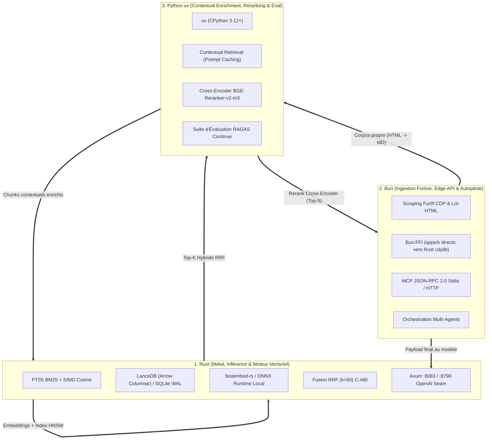
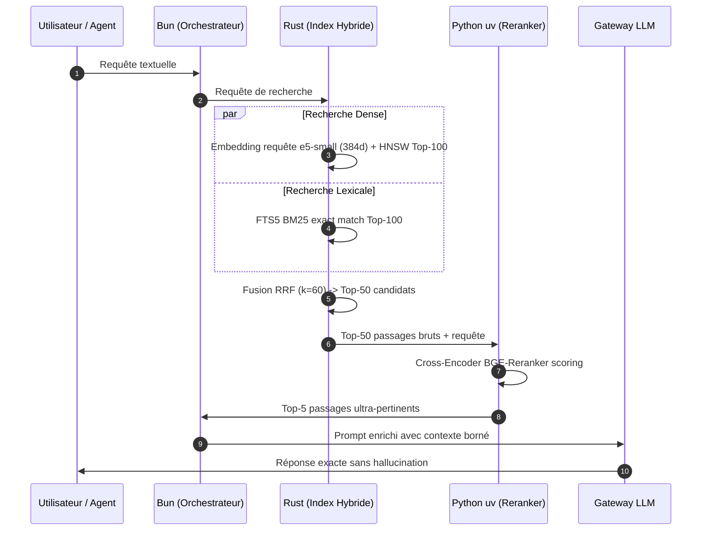

<!-- SPDX-License-Identifier: Apache-2.0 -->
# Deep Research — Best Unified RAG Stack 2026: Rust ✕ Bun ✕ Python (uv)

Ce document synthétise l'état de l'art mondial 2025/2026 de l'ingénierie RAG (Retrieval-Augmented Generation) haute performance, unifiée autour de la triade polyglotte **Rust**, **Bun** et **Python (uv)**.

---

## 1. Synthèse Exécutive : Pourquoi la Triade Polyglotte ?

En 2026, les architectures RAG dites « naïves » (chunking brut + embeddings simples + top-k vectoriel) sont obsolètes et présentent des taux d'échec de 30 à 50% en production. L'état de l'art impose une **architecture compositionnelle** où chaque langage excelle sur son domaine de prédilection :

---

## 2. Rôles et Spécialisations par Langage

### 2.1 Rust — Le noyau natif
- **Rôle** : Calcul vectoriel intensif, indexation, stockage in-process et serveur HTTP.
- **Technologies recommandées** :
  - **Moteur Vectoriel Embarqué** : **LanceDB** (format Apache Arrow columnar, requêtes vectorielles multi-millions en mémoire partagée zéro-copie) pour les gros volumes / multi-modal, et **SQLite WAL + FTS5 + extension SIMD vectorielle** pour le desktop/embarqué léger (< 100k chunks).
  - **Inférence Locale** : `fastembed-rs` et `ort` (ONNX Runtime C++ FFI) pour exécuter `intfloat/multilingual-e5-small` (384d) ou `bge-m3` localement sur GPU (CUDA 13 / TensorRT).
  - **Algorithmique** : Fusion de rangs réciproques (**RRF**) vectorisée avec AVX-512 / Neon.
  - **Serveur** : `axum` 0.8 avec streaming natif non bufferisé (`Body::from_stream`).

### 2.2 Bun — L'Orchestration Furtive & Interface Edge
- **Rôle** : Collecte furtive de données (scraping headless), passerelle MCP (Model Context Protocol) et runtime agentique.
- **Technologies recommandées** :
  - **Scraping & Ingestion** : `@aphrody-code/bxc` avec navigateur furtif CDP et parsing HTML via streaming V8/Rust.
  - **Liaison Bas Niveau** : `bun:ffi` connectant directement la bibliothèque dynamique Rust (`aphrody_rust.dll` / `.so`) sans overhead HTTP inter-processus.
  - **Protocole Agent** : `@modelcontextprotocol/sdk` servant le catalogue unifié d'outils RAG aux agents (Claude, Codex, Antigravity).

### 2.3 Python via `uv` — L'Intelligence Sémantique & Évaluation
- **Rôle** : Enrichissement contextuel des données, modèles complexes de reranking et validation continue de qualité.
- **Technologies recommandées** :
  - **Gestionnaire d'environnement** : `uv` (Astral), avec un cache global de paquets.
  - **Enrichissement Contextuel (Anthropic Pattern)** : Génération de 50 à 100 tokens situant chaque fragment dans la structure globale du document, avec **Prompt Caching** pour réduire les coûts d'inférence de 90%.
  - **Reranker** : `BAAI/bge-reranker-v2-m3` ou `cohere-rerank-v3` via FastEmbed ou PyTorch.
  - **Évaluation Continue** : `ragas` (mesure automatique de la fidélité, pertinence des réponses et précision contextuelle).

---

## 3. Le Pipeline de Retrieval État de l'Art 2026 (5 Étapes)

### 1. Ingestion Contextualisée
Au lieu de découper bêtement le texte en blocs de 500 tokens, chaque chunk est préfixé par un résumé contextuel de 50-100 tokens généré par LLM (ex: *"Ce passage traite des exceptions de sécurité dans le module aphrody-app-server..."*). Ce mécanisme élimine les échecs de recherche lorsque le chunk contient des pronoms ("il", "ce système") sans nommer l'entité.

### 2. Recherche Hybride Parallèle (Dense + BM25)
- **Dense** : Capture les analogies conceptuelles et les correspondances sémantiques multilingues (FR/EN/JP).
- **BM25 (Lexical)** : Capture les codes d'erreur, noms de fonctions, identifiants techniques et termes rares que les embeddings vectoriels diluent.

### 3. Normalisation et Reciprocal Rank Fusion (RRF)
La formule standard industrielle $k=60$ :
$$\text{RRF\_Score}(d) = \sum_{m \in \{\text{dense}, \text{bm25}\}} \frac{1}{60 + \text{rank}_m(d)}$$
Elle permet d'agréger sans biais d'échelle deux distributions de scores incompatibles.

### 4. Cross-Encoder Reranking
Contrairement aux bi-encoders (qui comparent deux vecteurs indépendants), le cross-encoder analyse la paire `(requête, passage)` simultanément dans le mécanisme d'attention. Bien que plus lourd, l'appliquer sur seulement 50 candidats réduit drastiquement les faux positifs et fait bondir la métrique NDCG@5 de plus de 35%.

### 5. Contrat d'Extraction Stricte
L'assistant est contraint de répondre en mode extractif d'abord : citation exacte des sources, mention explicite si l'information est absente du corpus, éliminant toute hallucination.

---

## 4. Comparatif Stratégique des Moteurs Vectoriels 2026

| Critère | **LanceDB** | **PostgreSQL 18 + `pgvector`** | **SQLite + `sqlite-vec` / BLOB SIMD** |
|---|---|---|---|
| **Nature** | Embarqué, orienté colonnes (Apache Arrow) | Extension base relationnelle client-serveur | Extension SQLite in-process / C-ABI |
| **Idéal pour** | Datasets volumineux, Edge, multi-modal | Centre de gravité unifié, multi-tenants, ACID | Applications desktop (Tauri), CLI, local |
| **Capacité optimale** | 1M à 50M vecteurs | 100k à 50M vecteurs (avec `pgvectorscale`) | 1k à 100k chunks |
| **Empreinte mémoire** | Basse (Zero-copy memory mapping disk-to-CPU) | Moyenne (mémoire dédiée shared buffers Postgres) | Très faible (< 50 Mo de RAM) |
| **Dépendance externe** | Aucune (lib Rust/Python/Bun) | Dépend d'un serveur PostgreSQL actif | Aucune (fichier `.db` unique) |

---

## 5. Application Concrète dans l'Écosystème Aphrody

L'écosystème Aphrody est déjà rigoureusement aligné avec ce standard d'excellence :
1. **Socle Rust** :
   - Crate `aphrody-rag-core` : implémente le store SQLite, l'indexation FTS5, la fusion RRF et l'extraction de sections.
   - Crate `aphrody-gateway` : routeur HTTP OpenAI-compatible desservant les modèles avec SSE streaming token-par-token.
   - Extension C-ABI Maturin (`py/aphrody/src/lib.rs` (not in repo)) fournissant le calcul vectoriel SIMD natif (`reciprocal_rank_fusion`, `cosine_similarity`).
2. **Collecte & Ingestion Bun** :
   - Moteur BXC (`packages/bxc` (not in repo)) assurant le crawling furtif et la conversion HTML en Markdown propre sans dépendances Node.
3. **Intelligence Python (uv)** :
   - Dossier `py/aphrody/` managé par `uv` avec sa suite de 281 tests validant la fidélité mathématique et l'intégration continue.
