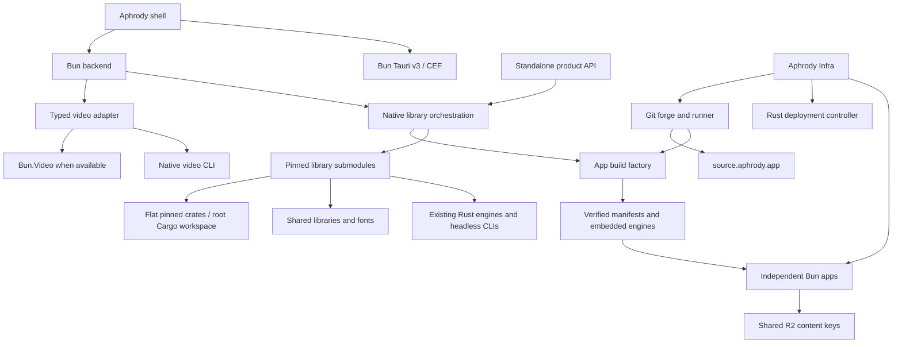

# Architecture

- `apps/desktop`: Aphrody shell, built and served by Bun.
- `packages/bun-workspace`: app identity, config, provenance, source coverage,
  native execution, asset manifests and shared process ownership.
- `packages/workspace`: OS CLI and adapters consuming that shared owner.
- `packages/bun-app-host`: product server, common authenticated API transport,
  standalone compilation and executable qualification.
- `packages/bun-video-project`: exact JSON, bounded native operations and runtime availability.
- `packages/bun-artifacts`: target manifests, standalone compilation and verified
  native payload extraction.
- `libraries/*`: pinned source forks awaiting complete crate ownership migration.
- `toolchains/bun`: pinned SDK and runtime types.

Imported libraries retain their history and licenses. The root Cargo workspace
owns the migrated flat crate submodules and common dependencies. Remaining
nested Cargo workspaces are migrated in qualified batches.

The shell exposes capabilities and headless inspection. Library sources do not
define product branding. GUI binaries are not launch targets.

Native builds use a host mutex and one Cargo job. The mutex is released before
headless execution. Compiled sidecars resolve a verified external Bun CLI for
native commands. Runtime and SDK source revisions are declared separately.

The desktop shell discovers its checkout or uses `APHRODY_ROOT`. Independent
app binaries embed their native engines and required resources. They run from
verified manifests without Git, Cargo or source discovery.

One workspace owner supplies app IDs, hashes, runtime provenance, source
coverage and child lifetimes. Adapters preserve native domain errors and
protocols. One shared R2 manifest references licensed assets by SHA-256.
Provider credentials, sessions, datasets and model weights remain isolated.

Aphrody Infra owns host, service, route and activation policy. Komodo actuates
deployment; Gitea and its runner host Git and execute the same Bun factory.
The root `bun-os` CLI routes `server` commands to the same app-host CLI owner.
Just coordinates setup, shared quality, Cargo, apps, product server and vendor
without implementing another build pipeline. The root owns `node_modules`,
`target`, `build` and `install`.

Source, artifact, CI and public service qualification are recorded separately.
The complete 239-repository Labs inventory and resumable mirror admission live
in Aphrody Infra. The embedded product catalog is a pinned distribution
snapshot, not a claim that every mirror or native application is qualified.
