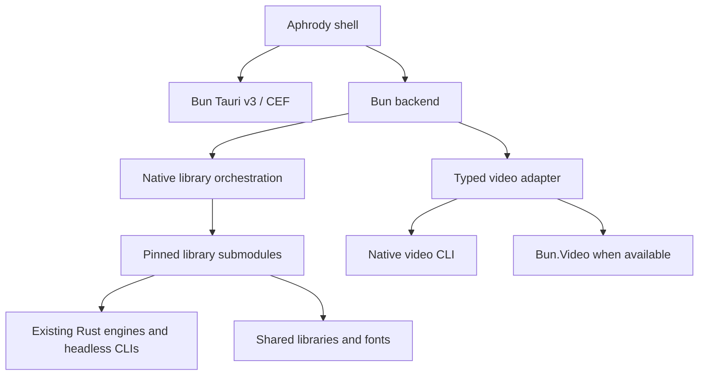

# Architecture

- `apps/desktop`: Aphrody shell, built and served by Bun.
- `packages/workspace`: config, provenance, source state and native execution.
- `packages/video`: exact JSON, bounded native operations and runtime availability.
- `libraries/*`: 16 independent open source forks.
- `toolchains/bun`: pinned SDK and runtime types.

Each library retains its history, licenses and Cargo workspace. Existing
dependency SHA pins remain unchanged. No global Cargo workspace or implicit
dependency override is created.

The shell exposes capabilities and headless inspection. Library sources do not
define product branding. GUI binaries are not launch targets.

Native builds use a host mutex and one Cargo job. The mutex is released before
headless execution. Compiled sidecars resolve a verified external Bun CLI for
native commands. Runtime and SDK source revisions are declared separately.

Installed shells discover the checkout or use `APHRODY_ROOT`. Engine binaries
and protected data are not bundled.
