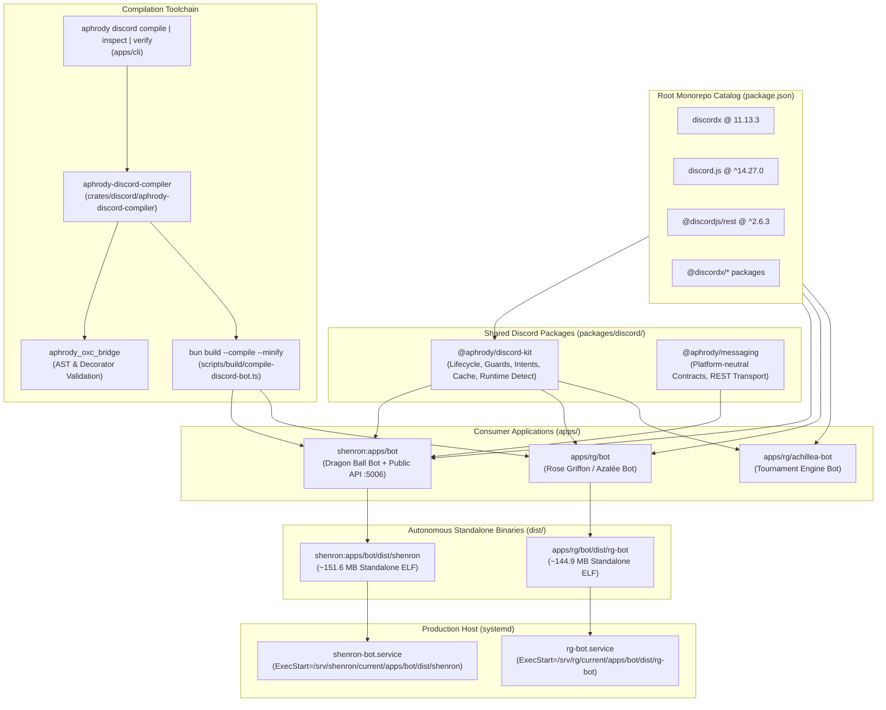

<!-- SPDX-License-Identifier: Apache-2.0 -->

# Aphrody Discord Architecture

This document defines the canonical architecture for Discord bots, libraries, and compilation pipelines within the Aphrody monorepo.

## 1. Executive Summary

Historically, Discord integration relied on an unwieldy vendored fork located under `upstream/discord` (containing snapshots of Discord.js and DiscordX totaling 3.9 GB and 2,232 files). 

As of **October 1, 2026**, Aphrody has achieved **complete Discord autonomy**:
- **Purge of `upstream/discord`**: 3.9 GB released from the monorepo; zero local forks of Discord.js or DiscordX.
- **Centralized Dependency Catalog**: All canonical Discord libraries (`discordx`, `@discordx/di`, `@discordx/pagination`, `@discordx/importer`, `@discordx/utilities`, `discord.js`, `discord-api-types`, `@discordjs/rest`) are managed strictly through `workspaces.catalog` in the root `package.json` under **Bun 1.4.2** and **TypeScript 7.0.2**.
- **Unified Shared Core (`@aphrody/discord-kit`)**: Shared bot runtime infrastructure (intent preflight negotiation, cache limits & sweepers, resilient interaction handling, graceful lifecycle shutdown, runtime environment detection).
- **Domain Channel Adapter (`@aphrody/messaging`)**: Zero-runtime-dependency message/room abstractions and Bun-native Discord REST operations.
- **Dual Rust + Bun Compiler (`aphrody-discord-compiler`)**: Native compilation orchestrator generating self-contained ELF/Mach-O binaries (`dist/shenron`, `dist/rg-bot`) embedding the Bun runtime and AOT-compiled bytecode, enabling host deployment without `node_modules` or host Bun runtimes.



---

## 2. Layered Architecture

### Layer 1: Centralized Dependency Catalog (`workspaces.catalog`)

Rather than maintaining fork checkouts, all Discord packages are defined centrally at the monorepo root:

```json
"workspaces": {
  "catalog": {
    "discordx": "11.13.3",
    "@discordx/di": "^3.3.4",
    "@discordx/pagination": "^4.4.2",
    "@discordx/importer": "^1.3.3",
    "@discordx/utilities": "^8.0.0",
    "discord.js": "^14.27.0",
    "discord-api-types": "^0.38.55",
    "@discordjs/rest": "^2.6.3"
  }
}
```

Every Discord bot and library imports these via `"catalog:"`, guaranteeing zero version drift across bots and zero duplicate runtime classes in memory.

### Layer 2: Core Shared Libraries (`packages/discord/`)

1. **`@aphrody/discord-kit` (`packages/discord/kit`)**:
   - **Intent Preflight Negotiation (`resolveGrantedIntents`)**: Queries the Discord API with the bot token before gateway initialization to verify which privileged gateway intents (Guild Members, Message Content, Presence) are granted in the Developer Portal. Dynamically downgrades unapproved intents to avoid the fatal `4014 Disallowed Intent` crash.
   - **Production Cache & Sweepers (`createProductionCacheOptions`)**: Calibrated memory sweepers for long-running 24/7 Bun processes. Sweeps stale messages every 30 minutes (retaining only 25 messages per channel), sweeps members, users, and threads to avoid unbounded memory leak under high Discord event traffic.
   - **Resilient Interaction Dispatcher (`safeExecuteInteraction`)**: Wraps interaction execution with error interception. If an interaction was already deferred (`deferReply`), recovers via `editReply`; if unreplied, answers with an ephemeral message; safely ignores non-repliable interaction types (e.g. autocomplete).
   - **Command Registration (`initApplicationCommandsSafe`, `clearGuildCommandsSafe`)**: Robust slash command sync with detailed `rawError` parsing and logging.
   - **Guards**: `@NotBot()` preventing bot loop execution, and `createMonoGuildGuard(guildId)` restricting administrative commands to the production guild.
   - **Runtime Detection (`isCompiledBinary`, `getBotRuntimeInfo`)**: Detects execution under standalone compiled binaries vs. raw `bun run` interpreted mode. Disables worker-thread-based logging (such as `pino-pretty` thread workers) when bundled in standalone mode.

2. **`@aphrody/messaging` (`packages/discord/aphrody-messaging`)**:
   - Platform-neutral channel communication contracts (`ChannelPort`, `SendMessageOptions`, `MessageRef`, `RoomRef`).
   - Pure Bun REST adapter with automatic 429 rate limit backoff and retry handling, multipart file uploads, and cancellable inbox streaming.

### Layer 3: Dual Compiler Pipeline (`crates/discord/aphrody-discord-compiler`)

Detailed in [`COMPILER.md`](COMPILER.md):
- Written in Rust with native CLI integration (`aphrody discord compile [target] [--smoke]`).
- Pre-compilation hooks (e.g. compiling Tailwind CSS for Shenron dashboard).
- Static AST validation using Oxc via `aphrody_oxc_bridge`.
- AOT compilation to standalone native binary via `bun build <entrypoint> --compile --minify --sourcemap --outfile=<path>`.
- Automated smoke testing (`--help`, `--version`, `--dry-run`) verifying binary sanity.

### Layer 4: Application Bots (`apps/`)

1. **`shenron:apps/bot` (`@shenron/bot`)**:
   - Dragon Ball canon database, interactive commands, card games, OCR integration, and public HTTP/REST/GraphQL API server on port 5006.
   - Entry point: `src/entry-standalone.ts`.
   - Output binary: `dist/shenron` (~151.6 MB).
2. **`iecode/apps/rg/bot` (`@rosegriffon/bot`)**:
   - Rose Griffon / Azalée Inazuma Eleven community bot, moderation, tournament coordination, XP and role sync.
   - Dual-profile dynamic dispatching (`rg` vs `azalee`) via static module loader registry (`src/modules.ts`).
   - Entry point: `src/entry-standalone.ts`.
   - Output binary: `dist/rg-bot` (~144.9 MB).
3. **`apps/rg/achillea-bot` (not in repo) (`@rosegriffon/achillea-bot`)**:
   - Tournament match automation and bracket management.

### Layer 5: Host Systemd Services (`systemd/`)

Detailed in [`docs/operations/discord/SYSTEMD-SERVICES.md`](../../operations/discord/SYSTEMD-SERVICES.md):
- `config/host/systemd/shenron/shenron-bot.service` executes `/srv/shenron/current/apps/bot/dist/shenron`.
- `iecode/config/rg/host/systemd/rg-bot.service` executes `/srv/rg/current/apps/bot/dist/rg-bot`.
- Complete elimination of host node_modules and Bun binary requirements.

---

## 3. Boundary Principles

1. **Separation of Concerns**: Discord protocols, decorators, and runtime lifecycles live in `@aphrody/discord-kit`. Domain logic, SQL schemas, business commands, and credentials remain strictly inside their respective applications (`shenron:apps/bot`, `iecode/apps/rg/bot`).
2. **No Duplicated Gateways**: Each application runs exactly one Discord Gateway connection. HTTP interaction webhooks and Gateway delivery are mutually exclusive.
3. **Deterministic Verification**: No change can be merged without passing `bun run discord:verify --compile` (100% pass across catalog audit, kit unit tests, messaging unit tests, bot suites, and AOT standalone compilation).
