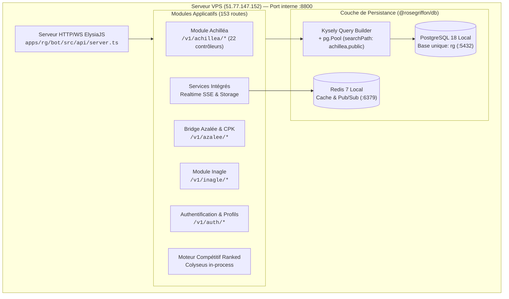

<!-- SPDX-License-Identifier: Apache-2.0 -->
# Architecture de l'API Rose Griffon & de la Persistance Données

Ce document constitue la référence d'architecture canonique décrivant la pile technologique, les dépendances vitales, les contrats de persistance et les flux réseau de l'**API unifiée Rose Griffon** et de son **moteur de base de données**.

---

## 1. Vue d'Ensemble & Environnement Runtime

L'ensemble de la couche API et persistance de Rose Griffon vit sous **Bun (>=1.4.2)** et **TypeScript (7.0.2)** au sein du monorepo Aphrody. Elle est hébergée par le démon unifié [`apps/rg/bot`](file:///home/aphro/aphrody/apps/rg/bot) (`rg-bot.service` sur port :8800) et consommée par le frontend Next.js 16 [`apps/rg/website`](file:///home/aphro/aphrody/apps/rg/website) (:3004).



---

## 2. Les 5 Dépendances Vitales de l'API & de la Base de Données

### 2.1. ElysiaJS & Écosystème (`elysia`, `@elysiajs/cors`, `@elysiajs/swagger`, `@elysia/eden`)
- **Version résolue** : `elysia@1.4.28`, `@elysiajs/cors@1.4.2`, `@elysiajs/swagger@1.3.1`, `@elysia/eden@1.4.10`.
- **Rôle** : Cœur du serveur HTTP et WebSocket. Sélectionné pour sa vitesse sous JavaScriptCore/Bun (traitement de requêtes jusqu'à 20x plus rapide qu'Express/Ts.ED), son système de plugins composable (`dbPlugin`), et sa validation stricte par schémas TypeBox (`t.Object`, `t.Numeric`, `t.Union`).
- **Typage End-to-End** : Le type TypeScript `App` exporté par `apps/rg/bot/src/api/server.ts` permet la génération de clients typés zero-cost via Eden Treaty côté front ou CLI :
  ```typescript
  import { treaty } from "@elysia/eden";
  import type { App } from "@rosegriffon/bot/api";
  const client = treaty<App>("https://api.rosegriffon.fr");
  ```
- **Documentation OpenAPI** : Swagger UI embarqué sur `/docs` exposant l'ensemble des contrats JSON Schema des 153 routes.

### 2.2. Kysely & Driver PostgreSQL (`kysely`, `pg`)
- **Version résolue** : `kysely@0.29.2`, `pg@8.21.0`, `@types/pg@8.20.0`.
- **Rôle** : Constructeur de requêtes SQL entièrement typesafe sans surcoût d'ORM ni magie de runtime.
- **Mutualisation des Schémas** : Configuration d'un `PostgresDialect` avec `searchPath: "achillea,public"`. Toutes les tables du domaine esport (`achillea.*`) et de la communauté Rose Griffon (`public.*`) sont interrogées sur la base PostgreSQL unique `rg`.
- **Gestion des Pools & Cycle de Vie** :
  - `createPgPool()` dans [`packages/rg/db/src/pg.ts`](file:///home/aphro/aphrody/packages/rg/db/src/pg.ts) borne les connexions (défaut : 4-8 connexions actives), applique un timeout de connexion de 5 000 ms et un keep-alive TCP.
  - Décoration automatique de l'instance Kysely dans le contexte de requête Elysia via `dbPlugin` :
    ```typescript
    export const db = createAchilleaSql<Database>() as Kysely<Database>;
    export const dbPlugin = new Elysia({ name: "db" }).decorate("db", db);
    ```
  - Arrêt propre (`destroyAchilleaSql()` et `sql.close({ timeout: 5 })`) sur `SIGTERM` / `SIGINT`.

### 2.3. Better Auth (`better-auth`, `@rosegriffon/auth`)
- **Version résolue** : `better-auth@1.7.6`, `@better-auth/{api-key,oauth-provider,passkey}@^1.7.6`.
- **Rôle** : Gestion de l'authentification unifiée multi-surfaces (sessions web RSC, jetons Bearer API, clés d'API et agent auth).
- **Montage Elysia** : Intégration directe du gestionnaire Better Auth dans le routeur principal via `.mount(elysiaAuth.handler)` et endpoint de configuration agent `/.well-known/agent-configuration`.
- **Politique de Session & Sécurité** :
  - Cookies de session signés avec portée étendue au domaine `.rosegriffon.fr` (`httpOnly`, `sameSite: "lax"`, `secure: true`), permettant aux RSC Next.js d'authentifier les requêtes sans pont de jetons complexe.
  - Résolution des identités unifiée avec repli Discord OAuth via la table `profiles`.

### 2.4. Colyseus Ranked & WebSockets Natifs (`@colyseus/bun-websockets`, `colyseus`)
- **Version résolue** : `colyseus@0.17.10`, `@colyseus/bun-websockets@0.17.13`.
- **Rôle** : Moteur compétitif temps réel pour les matchs classés Inazuma Eleven.
- **Convergence in-process** : Rapatrié du sous-processus externe d'Achilléa vers le démon unifié sous `apps/rg/bot/src/api/ranked`.
- **Salles gérées** :
  - `QueueRoom` : File d'attente matchmaking, appairage basé sur le classement ELO.
  - `MatchRoom` : Suivi d'état des scores, arbitrage de litiges, soumission des preuves de victoire.
  - `LobbyRoom` : Salons personnalisés pour les ligues et tournois communautaires.
- **Hub WebSocket Elysia** : Point d'accès WebSocket persistant sur `/v1/achillea/ws` (port :8800) avec broadcast par salons utilisateur (`user:${userId}`).

### 2.5. Framework Discord Souverain (`@aphrody/discord-kit`, `discordx`, `discord.js`)
- **Version résolue** : `@aphrody/discord-kit` (workspace), `discordx@11.13.3`, `discord.js@14.27.0`.
- **Rôle** : Interaction Discord multi-identités (`rg`, `azalee`, `achillea`) cohabitant dans le même processus que l'API.
- **Résilience** : Négociation pre-flight des intents autorisés (`resolveGrantedIntents`), nettoyage des slash commands obsolètes (`clearGuildCommandsSafe`), et mise en cache bornée adaptée aux processus long-running sous Bun (`createProductionCacheOptions`).

---

## 3. Topologie des Ports & Sécurité d'Exposition

En accord avec la matrice d'infrastructure et l'audit VPS :
- **Seuls les ports `80` (HTTP), `443` (HTTPS) et `22` (SSH)** sont ouverts sur l'interface réseau publique.
- **Port de l'API unifiée (`:8800`)** : Lié exclusivement à `127.0.0.1` (loopback), exposé sur le web public uniquement à travers le reverse proxy Nginx (`https://api.rosegriffon.fr`).
- **PostgreSQL (`:5432`) & Redis (`:6379`)** : Strictement isolés sur loopback. Aucune surface de base de données n'est accessible directement depuis l'extérieur.
