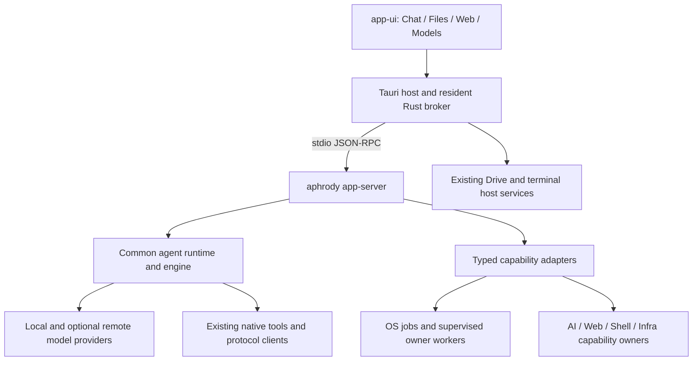

<!-- SPDX-License-Identifier: Apache-2.0 -->
# Workspace architecture

**Host decision, 2026-09-28:** the [native M3 plan](../../design/aphrody-m3/docs/plans/design/M3-MULTI-HOST-PLAN.md) owns migration
to Rust/winit/wgpu. Tauri references below describe the existing integration host;
the target preserves one shell and the out-of-process AI contract. Native delivery
requires its own platform, accessibility and installed-workflow evidence.

This page defines the boundaries between the source superproject, Aphrody's
category repositories and the domain applications that consume them. The
[cross-repository Spacedrive plan](../plans/workspace/PLAN.md) coordinates its absorption;
the active AI workstation delivery plan is
[aphrody-ai/docs/PLAN.md](../plans/ai/PLAN.md).
The desktop specification is [aphrody-ui/docs/GUI.md](../../design/aphrody-m3/docs/reference/GUI.md).
Priorities and acceptance criteria remain in those owning documents.

## Source root and repository ownership

`src` is a Git superproject. Its gitlinks pin child repository commits;
.gitmodules declares their paths and remotes. Each child keeps
its own history, instructions, manifests, toolchains, gates and releases.

The root owns checkout orchestration, the generated
manifest, Just recipes and workspace
documentation. It is neither an application
runtime nor a Cargo, Bun or uv workspace. Build and verification commands run in
the relevant child repository. A generated manifest describes a checkout; it
does not prove that a service or desktop artifact is deployed.

| Owner | Responsibility |
| --- | --- |
| [aphrody-contracts](../products/contracts/README.md) | Neutral wire types, JSON schemas, agent submission/events, app-server compatibility and A2A contracts |
| [aphrody-native](../products/native/README.md) | Native C/C++ and compute foundations, bridge ABIs and their Rust facade |
| [aphrody-os](../products/os/_source/README.md.712b5622bf2b) | Kernel/system capabilities, process supervision, jobs, secrets, sandbox/policy, WinClean, reverse engineering, plugin distribution and the FSL Drive engine/daemon |
| [aphrody-shell](../products/shell/README.md) | Nushell, terminal/PTY and TUI implementations |
| [aphrody-web](../products/web/README.md) | Obscura, BXC, browsing/extraction, web clients, aphrody-site as public HTTP origin and the transitory FSL Drive server |
| [aphrody-ui](../../design/aphrody-m3/docs/products/_source/README.md.8c1fe132fe5c) | The Aphrody Tauri desktop, app-ui shell, Material 3, Drive presentation and renderers; a retained Drive source copy remains during migration |
| [aphrody-koharu](../products/koharu/README.md) | Reusable Koharu project, page, scene, manga pipeline and model configuration libraries; Rust and Bun SDKs |
| [aphrody-compat](../products/compat/_source/README.md.038abe5c2ce0) | Bun/N2B compatibility facilities and documentation |
| [aphrody-ai](../products/ai/_source/README.md.a7d252bc425b) | Agent/runtime/tools, model clients and lifecycle, inference, RAG/memory, OCR/vision/voice, training, AI MCP/A2A, app-server and the `aphrody` CLI |
| [aphrody-infra](../products/infra/README.md) | Targets, topology, service/routes catalogues, release/deployment control, Git/SSH/VPN and remote operations |
| [aphrody-discord](../products/discord/README.md) | Shared Discord transport, protocol contracts and framework adapters; consuming applications retain commands, data, auth policy and secrets |
| [rg](https://github.com/aphrody-labs/iecode/blob/main/docs/rg/products/README.md), shenron, nie, iecode | Domain products, data and workflows consuming shared capabilities through their declared packages, libraries or service contracts |

The generated [ecosystem catalogue](../ecosystem/ECOSYSTEM.md),
[CLI tree](../ecosystem/CLI.md) and
[MCP tools](../ecosystem/MCP-TOOLS.md) are discovery indexes.
Actual manifests, dispatch code and enabled features determine a checkout's
capabilities. Do not duplicate their changing counts or dependency inventories here.

`aphrody-koharu` is currently an independent local checkout consumed by sibling
path dependencies. It has no configured remote or root Git submodule entry yet;
the generated ecosystem catalog describes its source, not a published release.
Koharu owns manga page processing, its model definitions, and its preferences.
`aphrody-ai` exposes this through the manga CLI and pipeline adapter, and owns
the versioned result and quality contract for general OCR. `aphrody-ui` owns
the editor presentation and its native SDK transport. Shenron owns databook
sources, transcription review, editorial records, and publication; shared
processing results enter Shenron only as unreviewed candidates. The verified
artifact catalog in `aphrody-ai` remains the authority for Aphrody-managed
model downloads.

## One workstation, explicit process boundaries

The desktop frontend is consolidated in `aphrody-ui/packages/app-ui`, as reported
by the user. Preserve that consolidation across the host migration: one desktop host, one `SpacesSidebar`,
one `TabBar`, four product zones. The installed artifact still needs the acceptance
evidence recorded by the product plan.

| Zone | Role |
| --- | --- |
| Chat | Agent conversation, tool output, reviewable changes and sessions |
| Files | VDFS exploration, preview, contextual inspector and object actions |
| Web | Browsing, extraction and crawling through existing web owners |
| Models | Hardware compatibility, verified downloads and local model readiness |

OCR, transcription, indexing and training are actions on selected objects. Progress,
artifacts and results return to those objects or conversation items. They do not
require a page per crate or a second navigation shell. Material 3 remains the
visual owner, with at least 18 px text, strong contrast, stable focus and keyboard/
screen-reader access. Exact interactions belong to the GUI specification.

This is the integration boundary, not a claim that every adapter is delivered.
Existing and pending paths are distinguished in the
[AI architecture](../architecture/ai/ARCHITECTURE.md) and its plan.

The desktop reaches the AI engine through `aphrody app-server`; it does not link
AI crates into the host. System, UI, Web, Shell, Native, Contracts and Compat must
not acquire reverse Cargo dependencies on `aphrody-ai`. AI consumes sibling
libraries through relative paths. Contracts and Native remain neutral foundations
without sibling dependencies. The manifests define the crate graph; repository
boundaries are not a claim that every category forms a simple linear layer.

## Native execution, jobs and resources

Native integration calls the existing library in its owning process and keeps
connections and expensive resources alive. A deterministic file/model action does
not need an LLM invocation, a freshly spawned CLI or several service proxies.
External MCP, A2A, remote SSH and client/server connections remain intentional
protocol boundaries. ACP is separate from the app-server wire contract.

Use `aphrody-jobs` in OS for durable background job identity/lifecycle, and existing
owner workers for model operations, OCR, speech, RAG, training and web extraction.
Extend its API where required; do not add a root scheduler or another SQLite queue.
`aphrody-proc` owns process supervision and resource primitives; Infra owns host
placement and deployment policy. AI owns model admission and inference/training
coordination through those existing mechanisms.

Heavy inference/media/browser runtimes use supervised process boundaries when
their isolation or runtime requires them. Keep crash containment and cancellation
explicit; do not revive the rejected design of one process embedding every
interpreter and GPU runtime. For native FFI, the allocator owning a buffer also
owns its release, and execution must respect each runtime's threading/lifetime
rules. A declared ABI is not proof that its engine is linked or operational.

Long operations return a turn or job handle, then report real progress and an
authoritative terminal state. Streams need bounded consumers, ordered item
identity, cancellation and reconnect recovery. Preserve durable session completion
barriers. Large model/audio/image artifacts travel through authorized references,
not repeated token-event payloads. Performance targets and measurements live in
the [product plan](../plans/ai/PLAN.md#latency-budgets).

The first trusted local coding slice may select full access explicitly. Restricted
modes must remain unavailable until every actual execution/file path enforces
them on the advertised platform. An OS policy type or process group alone does not
establish confinement. This distinction must remain visible in capability contracts.

## Domain products and data

RG and Shenron retain their application responsibilities. NIE remains the
source reference during the [convergence plan](../plans/workspace/PLAN.md#nie-convergence):
IECODE becomes the owner of IEVR-specific rules, data, formats and forge;
reusable technology moves to the relevant Aphrody category owner. This is a
target boundary, not a claim that its consumers have migrated.

| Application | Domain boundary |
| --- | --- |
| RG | Association, Azalée/Achilléa and the canonical platform authentication boundary |
| Shenron | Dragon Ball content, editorial/canon rules, ingestion, site and bot workflows; consumes RG authentication and shared AI capabilities |
| NIE | Pinned source and parity reference until its consumers and data have migrated |
| IECODE | Target owner of Victory Road rules, reconstruction/forge, game formats, data and specialist .NET/native/Python/Bun workflows; consumes shared Aphrody capabilities through explicit boundaries |

Their adapters consume the existing owners. A proposed technology consolidation
does not authorize deleting a domain service, archiving a repository or moving its
database schema. Historical convergence phases describe intended migrations, not proof of a completed
cutover. Current owner plans and Infra contracts determine each migration.

Keep one Better Auth boundary per public origin; Shenron consumes the RG boundary.
An OAuth client such as `aphrody-mcp-oauth` is not a user/session authority. Application
schema owners retain migrations; Infra owns database placement, backup and recovery
procedures. Reusable RAG/evaluation machinery stays in AI while corpus provenance,
domain validation and redistribution rights stay explicit. Runtime databases,
credentials and proprietary assets are not superproject source artifacts.

## Contracts and data ownership

| Boundary | Canonical source |
| --- | --- |
| Desktop requests, events and approval replies | App protocol; handlers in AI and broker in UI |
| Agent submissions/events and A2A | [Contracts repository](../products/contracts/README.md) and [A2A documentation](../products/contracts/a2a/README.md) |
| Services, health, routes and placement | Infra [service catalogue](../../config/service-catalog.json), [topology](../../config/production-topology.json), `yolo/config/host/nginx/routes.json`, [local AI](../../config/local-ai.json) |
| Jobs, process resources and native secrets | OS implementation and its actual APIs; AI adapters add feature-specific input/results |
| RAG, sessions, models and memory | AI owner crates; do not add root schema snapshots |
| Application databases | RG/Shenron and other application schema owners; Infra owns deployment/backup, not their business schema |

A schema describes vocabulary; implemented handlers and recorded scenarios define
supported behavior. ACP, A2A and app-server are distinct protocols. Keep version
negotiation, refusal paths and migration compatibility explicit. No root copy of
wire schemas, application SQL or infrastructure registries is maintained.

## Convergence decisions

Preserve the product direction without mistaking migration intent for current state:

- The product has one Aphrody desktop host (currently Tauri, targeting native Rust). Retired Inacord and Drive desktop
  hosts are not independent app targets to reintroduce; domain engines and the
  Drive runtime remain with their owners.
- Shared site/backend capability converges through `aphrody-web` and its existing
  server, with M3 presentation and domain-specific routes/content. Existing public
  services remain authoritative until replacement behavior, auth, SEO/status codes,
  assets and rollback have been qualified by their owners and Infra.
- The product MCP surface belongs to `aphrody-ai/aphrody-mcp`; domain adapters may
  supervise an existing owner process when dependency boundaries require it.
  Low-level system providers remain OS capabilities. Shared plugin distribution
  belongs to OS; this does not erase independently scoped tools or specialist plugins.
- Keep existing authentication/session and database contracts during convergence.
  A proposed Rust auth or bot migration is not permission to drop the existing
  service, reset user sessions or merge storage. Delivery lives in the owner plan.
- Reusable rendering, inference and extraction belong to their category libraries.
  Level-5 game-specific parsers move from NIE to IECODE; generic extraction
  belongs to its Aphrody system owner. Domain corpora retain provenance and
  redistribution constraints.

## Third-party provenance

Each owner records upstream URLs/revisions, local patches and the applicable
licenses next to imported code. Use its `.gitmodules`, `UPSTREAM`/notice files and
package locks rather than a second root SHA registry. The current reference for
AI extraction is [THIRD_PARTY_CODEX.md](../reference/ai/THIRD_PARTY_CODEX.md).

Preserve copyright/license notices when moving or adapting source. Application
code, model weights, fonts, brands, game assets and Drive-derived sources have
separate provenance. Apache-2.0 at the workspace/product entry does not relicense
all of them. Reuse behavior and public contracts without copying proprietary code.
Upstream bumps and patch retirement need owner-scoped evidence before release.

## Infrastructure and delivery authority

All hosts, addresses, ports, service identities, proxy routes and placement come
from [aphrody-infra](../products/infra/README.md), principally its `config/` and
`inventory/` sources. App repositories consume that authority; the root keeps no
parallel host map. BXC's canonical implementation is `aphrody-web/apps/bxc`.

Changing a route or service follows the owning Infra runbook with real parity
evidence, data protection and rollback. Preserve application auth/schema behavior
and public contracts during migrations. Never infer live state from a checkout or
resurrect retired units from historical plans. Root cleanup does not change runtime
directories, installed binaries or live infrastructure.

Changes are committed in their owning repositories; the superproject subsequently
records the intended child commits and generated snapshot. Each release identifies
its source closure, toolchains, supported platforms and actual distributed licenses.
Moving Drive-derived code does not change its license. An OSS claim requires the
complete distributed dependency/source closure and model terms to support it.

## Documentation and evidence

| Question | Authority |
| --- | --- |
| Where does a change belong? | This architecture, then the child repository's instructions and manifests |
| What is the workstation implementing next? | [AI delivery plan](../plans/ai/PLAN.md) |
| How does the desktop behave? | [GUI specification](../../design/aphrody-m3/docs/reference/GUI.md) and its UI/UX design documents |
| Which capability or command already exists? | [Generated ecosystem discovery](../ecosystem/ECOSYSTEM.md), then current source/help |
| What runs on a host? | Infra catalogues, release records and live evidence |
| What is pinned locally? | Gitlinks, child Git state and generated root manifest |

Preserve the difference between implemented source, user-reported checks, passing
repository gates and installed end-to-end qualification. Report `FAIT`, `INCOMPLET`
or `NON_FAIT` with the applicable evidence. Editing architecture documentation does
not qualify the runtime or create a second product plan.
